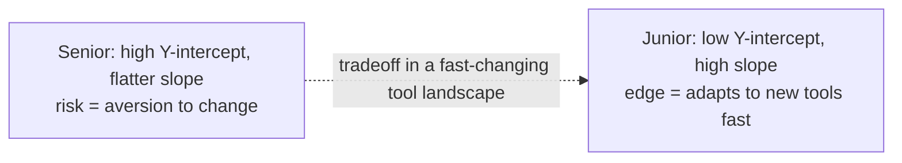

# 3. The Case for Junior Engineers

Question: is there even a need for junior engineers if AI is already as good as most software engineers? Eric's answer is an unambiguous **yes** [`3:45`](https://www.youtube.com/watch?v=Ci7ZDQ3m8cc&t=225).

## What juniors uniquely offer

- **Nimbleness** in picking up tools and skills, and tackling problems in a way that is "unopinionated in a good way" [`3:45`](https://www.youtube.com/watch?v=Ci7ZDQ3m8cc&t=225).
- Where Eric sees **seniors stumble is an aversion to change**, in a world that is evolving very quickly [`4:12`](https://www.youtube.com/watch?v=Ci7ZDQ3m8cc&t=252).

## The slope vs. Y-intercept model

Eric's framing for junior vs. senior value [`4:12`](https://www.youtube.com/watch?v=Ci7ZDQ3m8cc&t=252):

- **Y-intercept** = starting capability. The junior's is lower than the senior's.
- **Slope** = rate of picking up new tools and skills. The junior's is "incredibly high" and "a lot more robust."

- This matters **especially for smaller companies**: startups run on speed and the ability to adapt to problem spaces and change on a moment's notice — a meta skill juniors already have [`4:33`](https://www.youtube.com/watch?v=Ci7ZDQ3m8cc&t=273).

## The tension in the interview

- Juniors are valuable *and* companies aren't hiring them. Eric resolves this not by denying junior value but by blaming **employer short-termism** — see [01 — The Junior Hiring Squeeze](01-the-junior-hiring-squeeze.md) [`5:43`](https://www.youtube.com/watch?v=Ci7ZDQ3m8cc&t=343).
