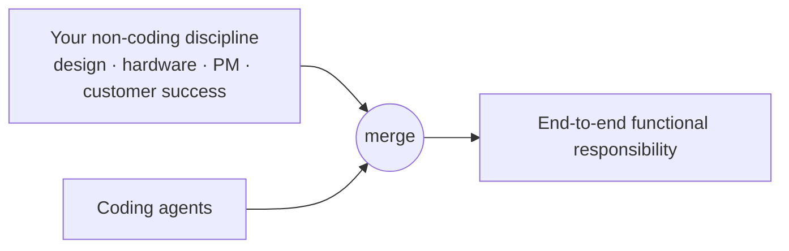

# 5. How to Avoid Being Replaced: Become Interdisciplinary

Eric's single headline recommendation: **"spend a lot of time becoming interdisciplinary"** [`7:16`](https://www.youtube.com/watch?v=Ci7ZDQ3m8cc&t=436).

## The worked example: the UX student

One of Eric's students, with a strong UX/UI background, built a system that [`7:16`](https://www.youtube.com/watch?v=Ci7ZDQ3m8cc&t=436):

1. Takes the rough notebook sketches designers already make when conceptualizing — meeting her where she is
2. Immediately translates them into an app **hosted on Vercel**
3. Result: a **fully functional, interactive web app**, with fidelity to the original sketch that Eric describes as "crazy good" [`7:39`](https://www.youtube.com/watch?v=Ci7ZDQ3m8cc&t=459)

The pattern: she **merged two disciplines** — design and coding agents — rather than competing inside one [`7:39`](https://www.youtube.com/watch?v=Ci7ZDQ3m8cc&t=459).

## The generalizable formula

- Same pattern for people strong in **hardware systems** who combine that with a coding agent to build something specific to their discipline [`7:39`](https://www.youtube.com/watch?v=Ci7ZDQ3m8cc&t=459).
- Disciplines Eric names as mergeable: **design, PM, customer success** [`7:39`](https://www.youtube.com/watch?v=Ci7ZDQ3m8cc&t=459).
- The goal is combining multiple roles and responsibilities into an **end-to-end functional responsibility** [`8:03`](https://www.youtube.com/watch?v=Ci7ZDQ3m8cc&t=483).

## Why this specifically defends against agents

- This is "one really big thing … that agents don't really do very well" [`8:03`](https://www.youtube.com/watch?v=Ci7ZDQ3m8cc&t=483).
- The reason: **"it's all that context that comes from the world"** — the part an agent cannot pull from a codebase [`8:03`](https://www.youtube.com/watch?v=Ci7ZDQ3m8cc&t=483).
