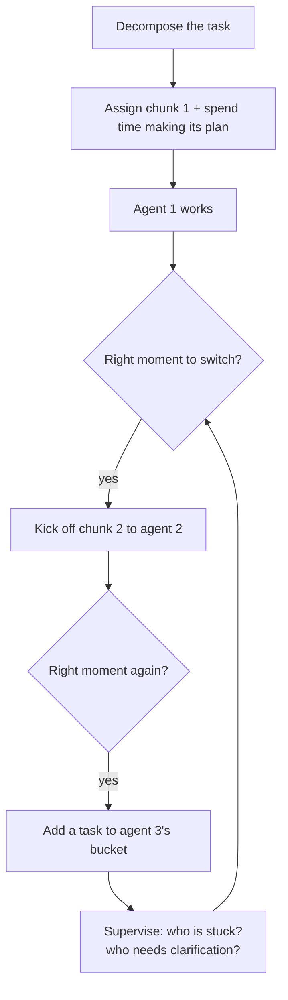

# 6. How to Become a Top 1% Engineer

Eric names **three skills** that separate the top 1% in an agentic workflow [`8:23`](https://www.youtube.com/watch?v=Ci7ZDQ3m8cc&t=503):

1. Thinking about problems in **piecemeal fashion**
2. Knowing how to **context switch** among parts of the problem and among agents
3. Knowing how to develop **agent-friendly codebases**

---

## Skill 1 — Piecemeal problem decomposition

- "The best engineers are the ones that know how to take a very complex task and then break it down to the subtasks that need to get organized" [`8:45`](https://www.youtube.com/watch?v=Ci7ZDQ3m8cc&t=525).
- Decomposition includes translating the **dependencies** between subtasks, not just listing them [`8:45`](https://www.youtube.com/watch?v=Ci7ZDQ3m8cc&t=525).
- Only from that place can you kick work off to agents [`8:45`](https://www.youtube.com/watch?v=Ci7ZDQ3m8cc&t=525).

## Skill 2 — Context switching across agents

The concrete loop Eric describes [`9:05`](https://www.youtube.com/watch?v=Ci7ZDQ3m8cc&t=545):

- The hard part is **knowing the right point to switch** to another agent and kick off the next piece [`9:05`](https://www.youtube.com/watch?v=Ci7ZDQ3m8cc&t=545).
- Moving seamlessly between multiple working agents is "a pretty complex skill because it's a bit like a psychological skill" — tracking what's going on with each agent, where it's stuck, where it needs more clarification [`9:25`](https://www.youtube.com/watch?v=Ci7ZDQ3m8cc&t=565) [`9:42`](https://www.youtube.com/watch?v=Ci7ZDQ3m8cc&t=582).
- **The mental model both parties land on**: *"You're the scrum master of a team of agents"* — the manager who has to maintain all the context, because agents are "the most eager interns on the planet." They do exactly what you ask, but they need supervision [`9:42`](https://www.youtube.com/watch?v=Ci7ZDQ3m8cc&t=582) [`10:00`](https://www.youtube.com/watch?v=Ci7ZDQ3m8cc&t=600).

## Skill 3 — Agent-friendly codebases

Eric flags this as **"not talked about enough"** [`10:00`](https://www.youtube.com/watch?v=Ci7ZDQ3m8cc&t=600). The principle: **set your agents up for success**.

Concrete requirements named:

- **Strong test coverage** in the codebase [`10:00`](https://www.youtube.com/watch?v=Ci7ZDQ3m8cc&t=600)
- **A strong build system** [`10:00`](https://www.youtube.com/watch?v=Ci7ZDQ3m8cc&t=600)

The analogy: **the house is built before someone enters it and starts adding a room on top** [`10:20`](https://www.youtube.com/watch?v=Ci7ZDQ3m8cc&t=620).

- Payoff: only once that foundation exists can you confidently run **multiple agents in parallel** without them producing sloppy code, trusting they'll build in the context of the foundation you set up [`10:20`](https://www.youtube.com/watch?v=Ci7ZDQ3m8cc&t=620).
