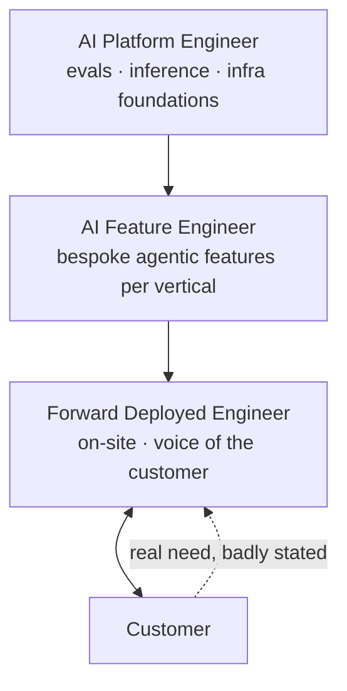

# 7. Three Tech Jobs That Will Explode Because of AI

The title claim of the video. Asked for the top three roles that will explode in the next 5 years, Eric names [`10:48`](https://www.youtube.com/watch?v=Ci7ZDQ3m8cc&t=648):

1. **Forward Deployed Engineer (FDE)**
2. **AI Platform Engineer**
3. **AI Feature Engineer**

Roles 2 and 3 are related but, in Eric's view, "distinct enough" to count separately [`11:34`](https://www.youtube.com/watch?v=Ci7ZDQ3m8cc&t=694).

---

## 1. Forward Deployed Engineer

- **What it is**: an engineer who goes **on site** with a company's customer and is responsible for translating customer demands or needs into software, using whatever platform you're selling them [`10:48`](https://www.youtube.com/watch?v=Ci7ZDQ3m8cc&t=648).
- **Why it grows**: it is **interdisciplinary** — it combines on-the-ground PM/support work with an understanding of your own codebase [`10:48`](https://www.youtube.com/watch?v=Ci7ZDQ3m8cc&t=648) [`11:08`](https://www.youtube.com/watch?v=Ci7ZDQ3m8cc&t=668).
- **The core skill is decomposition and translation** — the same skill from [06](06-the-top-1-percent-engineer.md), applied to customers instead of agents [`11:08`](https://www.youtube.com/watch?v=Ci7ZDQ3m8cc&t=668).
- **The concrete example**: the user says *"this button doesn't work"*, but what they really mean is there's a whole different feature they didn't even know they needed. Users latch onto the wrong particular detail; the FDE is **the voice of the customer**, translating it into engineering [`11:08`](https://www.youtube.com/watch?v=Ci7ZDQ3m8cc&t=668).

## 2. AI Platform Engineer

- **What it is**: the person building the **foundation on which agents get built** [`11:34`](https://www.youtube.com/watch?v=Ci7ZDQ3m8cc&t=694).
- **The decisions they own**, with the tools Eric names:
  - **Evaluation** — Brain Trust, Judgment Labs, or similar foundational software [`11:34`](https://www.youtube.com/watch?v=Ci7ZDQ3m8cc&t=694)
  - **Inference / self-hosted models** — Fireworks, Modal, or other providers [`11:54`](https://www.youtube.com/watch?v=Ci7ZDQ3m8cc&t=714)
- **The scope**: platform infrastructure foundations upon which agentic capabilities get built [`11:54`](https://www.youtube.com/watch?v=Ci7ZDQ3m8cc&t=714).
- **Host's shorthand**, which Eric accepts: *"kind of like the AI IT department"* [`11:54`](https://www.youtube.com/watch?v=Ci7ZDQ3m8cc&t=714).

## 3. AI Feature Engineer

- **What it is**: once the foundational infrastructure layer exists company-wide, this is the person building **bespoke agentic features on top of it** [`12:11`](https://www.youtube.com/watch?v=Ci7ZDQ3m8cc&t=731).
- **The worked example**: building an agent that does summarization really well, **grounded in PDFs specific to insurance** if you're in the insurance vertical [`12:11`](https://www.youtube.com/watch?v=Ci7ZDQ3m8cc&t=731).
- The distinction from role 2 is **layer, not seniority**: platform builds the substrate, feature builds the vertical-specific product on it [`12:11`](https://www.youtube.com/watch?v=Ci7ZDQ3m8cc&t=731).

---

## How the three stack

