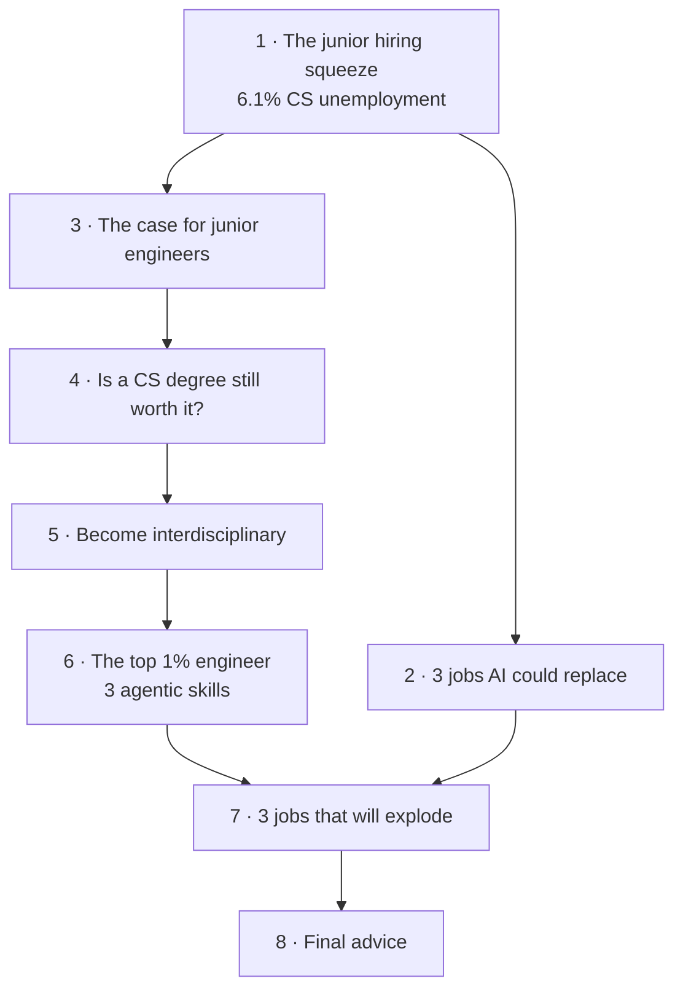

# Stanford AI Expert: These 3 Jobs Will EXPLODE in the Next 5 Years!

*Sajjaad Khader · 13:50 · [Watch on YouTube](https://www.youtube.com/watch?v=Ci7ZDQ3m8cc)*

## Summary

An interview with **Mihail Eric**, Stanford lecturer and head of AI, on where software engineering is actually headed under coding agents. Eric argues the job market squeeze on CS grads is real and measurable, but that the thing being replaced is a *shape of work* — spec-in, code-out ticket execution — not engineering itself. He names three roles he expects to disappear, three he expects to explode, and the three concrete skills that separate the engineers who thrive: task decomposition, context switching across multiple agents, and building agent-friendly codebases. He closes by pushing back hard on the idea that juniors have no future, and says he's hiring them.

## Topics

1. [The Junior Hiring Squeeze](01-the-junior-hiring-squeeze.md) — the 6.1% unemployment number, the vanished ramp-up buffer, and why employers pick seniors
2. [Three Tech Jobs AI Could Replace](02-three-tech-jobs-ai-could-replace.md) — manual QA, entry-level consulting, entry-level data analysis, and the criterion behind all three
3. [The Case for Junior Engineers](03-the-case-for-junior-engineers.md) — the slope vs. Y-intercept model and why startups need it
4. [Is a CS Degree Still Worth It?](04-is-a-cs-degree-still-worth-it.md) — 2021 vs. 2026 economics, and the meta skills that justify the cost
5. [How to Avoid Being Replaced: Become Interdisciplinary](05-become-interdisciplinary.md) — the UX-student-to-Vercel-app example and the merge formula
6. [How to Become a Top 1% Engineer](06-the-top-1-percent-engineer.md) — decomposition, agent context switching, agent-friendly codebases
7. [Three Tech Jobs That Will Explode](07-three-tech-jobs-that-will-explode.md) — forward deployed engineer, AI platform engineer, AI feature engineer
8. [Final Advice](08-final-advice.md) — the trap to avoid, and Eric's own hiring position

## Key takeaways

- **Computer science sits at 6.1% unemployment — seventh highest among all college degrees**, and Eric attributes it to an expectation gap rather than to AI directly replacing headcount [`0:51`](https://www.youtube.com/watch?v=Ci7ZDQ3m8cc&t=51) [`2:02`](https://www.youtube.com/watch?v=Ci7ZDQ3m8cc&t=122).
- **The 3–12 month ramp-up buffer for new grads is gone.** Facing two candidates for one role, employers now pick the senior specifically because they need less ramp-up — which Eric calls myopic [`1:17`](https://www.youtube.com/watch?v=Ci7ZDQ3m8cc&t=77) [`1:38`](https://www.youtube.com/watch?v=Ci7ZDQ3m8cc&t=98).
- **The replaceable category is defined by task shape, not title**: work describable as a Jira/Linear ticket, where you take a spec and execute it, is easy to outsource to a coding agent — which covers most outsourced and body-shop consulting labor [`2:21`](https://www.youtube.com/watch?v=Ci7ZDQ3m8cc&t=141) [`3:36`](https://www.youtube.com/watch?v=Ci7ZDQ3m8cc&t=216).
- **Three roles Eric expects to disappear**: manual QA engineers, entry-level consultants, entry-level data analysts [`2:54`](https://www.youtube.com/watch?v=Ci7ZDQ3m8cc&t=174) [`3:17`](https://www.youtube.com/watch?v=Ci7ZDQ3m8cc&t=197).
- **Three roles Eric expects to explode**: forward deployed engineer, AI platform engineer (owning eval and inference choices — Brain Trust, Judgment Labs, Fireworks, Modal), and AI feature engineer (bespoke vertical agents on top of that platform) [`10:48`](https://www.youtube.com/watch?v=Ci7ZDQ3m8cc&t=648) [`11:34`](https://www.youtube.com/watch?v=Ci7ZDQ3m8cc&t=694) [`12:11`](https://www.youtube.com/watch?v=Ci7ZDQ3m8cc&t=731).
- **Juniors win on slope, not intercept.** Their starting capability is lower, but their rate of picking up new tools is far higher — and Eric says the place seniors stumble is aversion to change, which matters most at speed-driven startups [`4:12`](https://www.youtube.com/watch?v=Ci7ZDQ3m8cc&t=252) [`4:33`](https://www.youtube.com/watch?v=Ci7ZDQ3m8cc&t=273).
- **The junior hiring freeze is a short-term optimization**, not a considered strategy: managers with a head count mandate default to "cut people, throw more cloud tokens at it" [`5:43`](https://www.youtube.com/watch?v=Ci7ZDQ3m8cc&t=343) [`6:06`](https://www.youtube.com/watch?v=Ci7ZDQ3m8cc&t=366).
- **A CS degree pays off only for meta skills** — scoping open-ended projects, talking to people, defining requirements — not for "learn Python, walk out with a job," a framing Eric rejects outright [`6:14`](https://www.youtube.com/watch?v=Ci7ZDQ3m8cc&t=374) [`6:42`](https://www.youtube.com/watch?v=Ci7ZDQ3m8cc&t=402).
- **Merging a second discipline with coding agents is the strongest defense**, demonstrated by a UX student whose system turned rough notebook sketches into a functional Vercel-hosted web app with fidelity Eric called "crazy good" — because the edge is world context, which agents lack [`7:16`](https://www.youtube.com/watch?v=Ci7ZDQ3m8cc&t=436) [`7:39`](https://www.youtube.com/watch?v=Ci7ZDQ3m8cc&t=459) [`8:03`](https://www.youtube.com/watch?v=Ci7ZDQ3m8cc&t=483).
- **Top-1% engineering is now three skills**: decomposing complex tasks with their dependencies, context switching across parallel agents ("you're the scrum master of a team of agents" who are "the most eager interns on the planet"), and preparing agent-friendly codebases [`8:23`](https://www.youtube.com/watch?v=Ci7ZDQ3m8cc&t=503) [`8:45`](https://www.youtube.com/watch?v=Ci7ZDQ3m8cc&t=525) [`9:42`](https://www.youtube.com/watch?v=Ci7ZDQ3m8cc&t=582).
- **Agent-friendly means strong test coverage and a strong build system, in place first** — build the house before anyone adds rooms — and only then is running multiple agents in parallel safe from sloppy output [`10:00`](https://www.youtube.com/watch?v=Ci7ZDQ3m8cc&t=600) [`10:20`](https://www.youtube.com/watch?v=Ci7ZDQ3m8cc&t=620).
- **The forward deployed engineer's real job is translation**: a customer reporting "this button doesn't work" often needs an entirely different feature they don't know exists [`11:08`](https://www.youtube.com/watch?v=Ci7ZDQ3m8cc&t=668).
- **"It's a wrong prediction to say that there's no hope for juniors at all in this new world"** — and Eric backs it with the statement that he is currently hiring the right kind of junior engineers [`13:10`](https://www.youtube.com/watch?v=Ci7ZDQ3m8cc&t=790).

---

The full [transcript](transcript.md) is included in this folder for reference.
