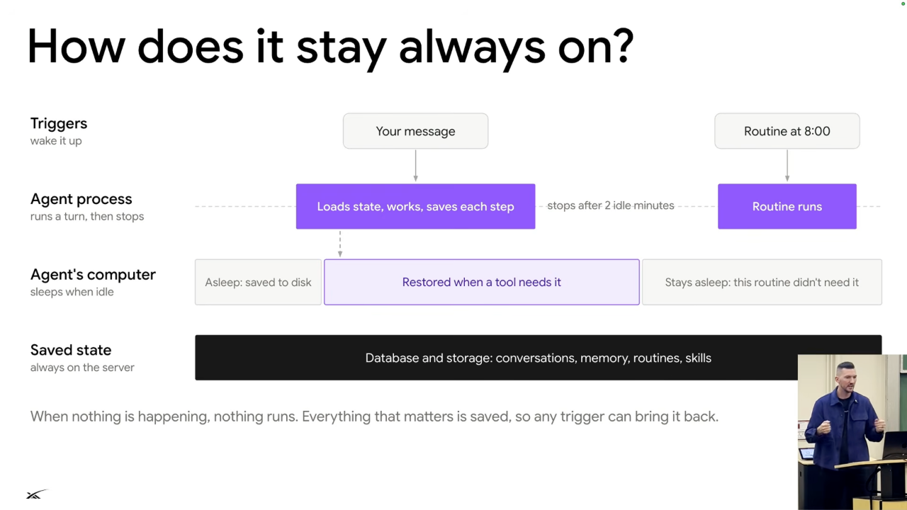
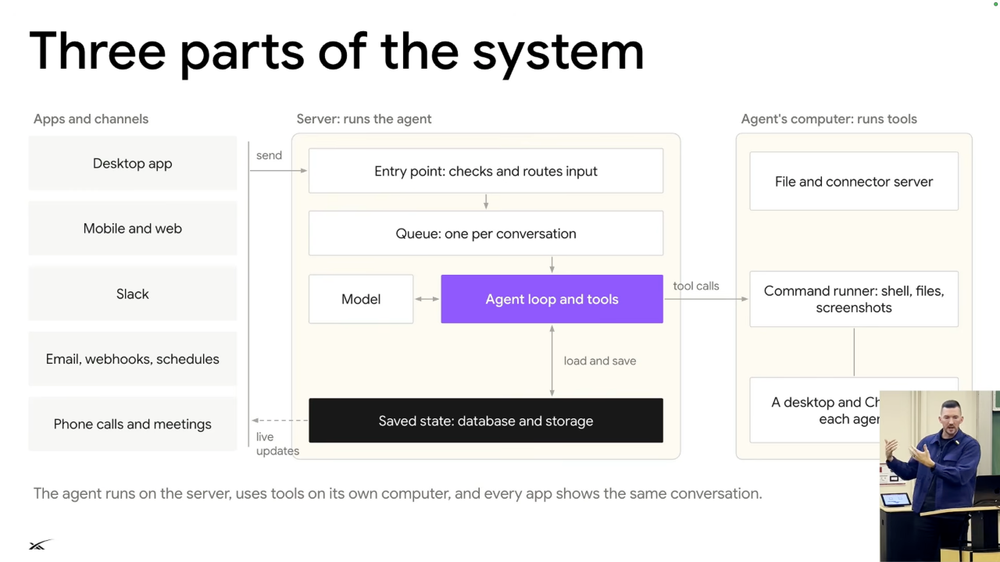

# Architecture and agent lifecycle

## Wake, work, persist, sleep

*Figure 1. A trigger wakes the agent process; the computer wakes only when a tool needs it. Saved state survives both going idle. Source: leerob, [`10:35`](https://www.youtube.com/watch?v=L1OBRtfPS34&t=635).*

1. Start with the agent server and its computer asleep. A user message or another trigger wakes the server and loads the agent's state. [`10:05`](https://www.youtube.com/watch?v=L1OBRtfPS34&t=605) [`10:35`](https://www.youtube.com/watch?v=L1OBRtfPS34&t=635)
2. Start the computer only if the task needs it, such as for browser interaction. Server and computer resources can return to sleep afterward. [`10:35`](https://www.youtube.com/watch?v=L1OBRtfPS34&t=635)
3. Persist conversation logs, memories, and routines in storage. Sleeping avoids the expense and resource demand of keeping everyone's server and computer active continuously. [`10:58`](https://www.youtube.com/watch?v=L1OBRtfPS34&t=658)
4. Route incoming events into the conversation, deduplicate them, and decide whether the user needs a notification. Background progress should not automatically become an interruption. [`11:43`](https://www.youtube.com/watch?v=L1OBRtfPS34&t=703) [`12:13`](https://www.youtube.com/watch?v=L1OBRtfPS34&t=733)

*Figure 2. Apps feed a server-side queue and agent loop. The loop saves state centrally and calls tools on a separate computer. Source: leerob, [`13:30`](https://www.youtube.com/watch?v=L1OBRtfPS34&t=810).*

## Cloud computer

- The Linux computer runs in a Firecracker VM. Snapshots let it shut down and resume; the user can also connect to a live view and control it. [`12:13`](https://www.youtube.com/watch?v=L1OBRtfPS34&t=733)
- Shell commands run in a secured environment separate from the user's laptop. Chrome and virtual desktops let multiple bots use distinct screens within shared infrastructure. [`12:43`](https://www.youtube.com/watch?v=L1OBRtfPS34&t=763) [`13:08`](https://www.youtube.com/watch?v=L1OBRtfPS34&t=788)
- The core remains a model using tools in a loop. Queues, persistence, computers, and service connections turn that small core into a broader product. [`13:30`](https://www.youtube.com/watch?v=L1OBRtfPS34&t=810)
