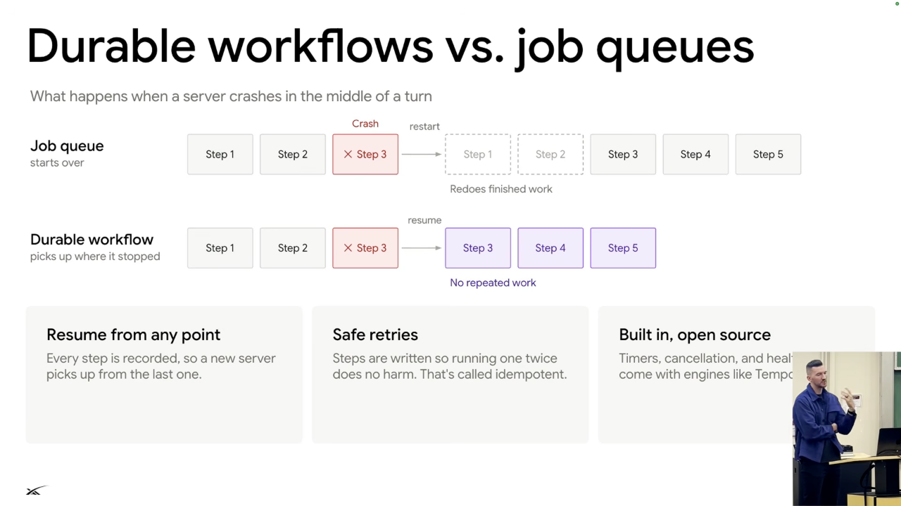

# Server mechanics and durable execution

## Why the loop lives on the server

- A thin client and thick server allow agent-code updates without shipping an App Store update. Servers also support heavy computation and established scaling approaches. [`14:07`](https://www.youtube.com/watch?v=L1OBRtfPS34&t=847) [`14:30`](https://www.youtube.com/watch?v=L1OBRtfPS34&t=870)
- Keep the agent loop separate from the computer VM. Otherwise shutting down the VM also shuts down the loop. Server-side state lets the team rebuild a VM for a critical Linux update without discarding the agent's execution state. [`14:30`](https://www.youtube.com/watch?v=L1OBRtfPS34&t=870) [`15:04`](https://www.youtube.com/watch?v=L1OBRtfPS34&t=904)

## Message delivery and synchronization

1. Acknowledge a sent message promptly in the client. [`15:27`](https://www.youtube.com/watch?v=L1OBRtfPS34&t=927)
2. Execute model/tool turns and save their state to the database. [`15:52`](https://www.youtube.com/watch?v=L1OBRtfPS34&t=952)
3. Notify subscribed clients of changes; clients fetch the latest server data. Deduplication prevents retries from appearing as duplicate messages. [`15:52`](https://www.youtube.com/watch?v=L1OBRtfPS34&t=952)

## Recovering work after crashes

*Figure 3. The lecture contrasts replaying completed work with resuming a durable workflow at the interrupted step. Safe retries still require idempotent steps. Source: leerob, [`16:42`](https://www.youtube.com/watch?v=L1OBRtfPS34&t=1002).*

- Lee contrasts a basic job queue that replays earlier steps after failure with a durable workflow that resumes at the interrupted step. The design goal is safe retries without restarting the entire task. [`16:18`](https://www.youtube.com/watch?v=L1OBRtfPS34&t=978) [`16:42`](https://www.youtube.com/watch?v=L1OBRtfPS34&t=1002)
- The team uses the open-source tool Temporal for durable execution rather than rebuilding those recovery mechanisms. They still operate the infrastructure. [`17:06`](https://www.youtube.com/watch?v=L1OBRtfPS34&t=1026)

## Scheduling turns

- Direct user instructions take priority. A correction such as changing an event date should stop the current loop so it can incorporate the new instruction. [`17:25`](https://www.youtube.com/watch?v=L1OBRtfPS34&t=1045)
- Group-chat messages, Slack threads, and routines enter the queue behind higher-priority work. Several messages arriving close together can be batched into one turn; the loop processes turns sequentially. [`17:25`](https://www.youtube.com/watch?v=L1OBRtfPS34&t=1045) [`18:00`](https://www.youtube.com/watch?v=L1OBRtfPS34&t=1080)
