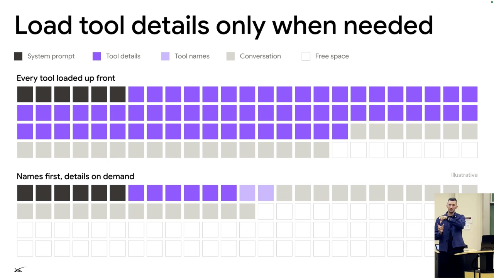
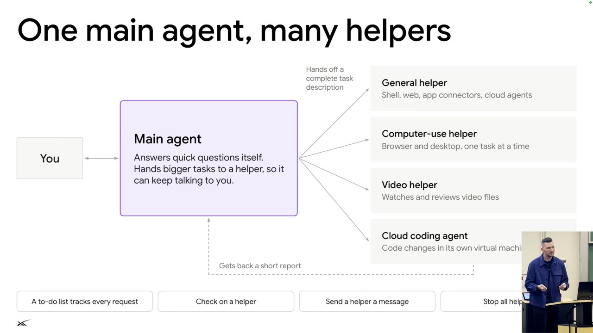

# Building the agent harness

## Client communication

- In the described Grokbot architecture, `send to user` is the single tool for communication between server and client. Shell commands, file access, cloud agents, and demo recording remain server-side. [`18:08`](https://www.youtube.com/watch?v=L1OBRtfPS34&t=1088) [`18:30`](https://www.youtube.com/watch?v=L1OBRtfPS34&t=1110)
- Mobile, desktop, email, and Slack clients share that communication mechanism but can render responses differently. Clients can show sign-in flows, payment interactions, editable approval drafts, or emoji reactions. [`19:00`](https://www.youtube.com/watch?v=L1OBRtfPS34&t=1140) [`19:23`](https://www.youtube.com/watch?v=L1OBRtfPS34&t=1163) [`19:54`](https://www.youtube.com/watch?v=L1OBRtfPS34&t=1194)

## Discover tools without filling the context

*Figure 4. Loading tool names first and details on demand leaves more context for the conversation. The blocks are illustrative, not benchmark measurements. Source: leerob, [`20:48`](https://www.youtube.com/watch?v=L1OBRtfPS34&t=1248).*

- Every tool definition consumes context through its name, schema, and description. Loading all connector tools leaves less room for actual work. [`19:54`](https://www.youtube.com/watch?v=L1OBRtfPS34&t=1194) [`20:20`](https://www.youtube.com/watch?v=L1OBRtfPS34&t=1220)
- Dynamic discovery initially includes tool names, then lets the model retrieve detailed instructions from files when it needs a tool. This reduces context usage and cost. [`20:48`](https://www.youtube.com/watch?v=L1OBRtfPS34&t=1248) [`21:15`](https://www.youtube.com/watch?v=L1OBRtfPS34&t=1275)
- Keep schemas concise and avoid adding or removing tools during turns, which also matters for prompt caching. [`25:17`](https://www.youtube.com/watch?v=L1OBRtfPS34&t=1517)

## Escalate through cheaper ways to get information

The lecture proposes trying the cheapest or most reliable available option first, then escalating as needed. [`21:31`](https://www.youtube.com/watch?v=L1OBRtfPS34&t=1291)

1. Use information already in the conversation. [`21:31`](https://www.youtube.com/watch?v=L1OBRtfPS34&t=1291)
2. Query a plugin, MCP server, or API, such as Plaid for banking data. [`21:31`](https://www.youtube.com/watch?v=L1OBRtfPS34&t=1291)
3. Try web search. [`21:57`](https://www.youtube.com/watch?v=L1OBRtfPS34&t=1317)
4. Use the computer's browser. [`21:57`](https://www.youtube.com/watch?v=L1OBRtfPS34&t=1317)
5. Use the full desktop, scripts, or commands. [`21:57`](https://www.youtube.com/watch?v=L1OBRtfPS34&t=1317)
6. Ask the user when other routes fail or their input or approval is needed. [`22:21`](https://www.youtube.com/watch?v=L1OBRtfPS34&t=1341) [`23:06`](https://www.youtube.com/watch?v=L1OBRtfPS34&t=1386)

- Browser observations can use screenshots, HTML, or the accessibility tree. The accessibility tree reduces token use while identifying buttons, links, and other elements. Pixel clicks remain useful for interfaces that structured inspection cannot handle. [`22:37`](https://www.youtube.com/watch?v=L1OBRtfPS34&t=1357) [`23:06`](https://www.youtube.com/watch?v=L1OBRtfPS34&t=1386)
- Two-factor authentication or a CAPTCHA may require returning to the user. [`23:06`](https://www.youtube.com/watch?v=L1OBRtfPS34&t=1386)

## Delegate verbose work

*Figure 5. The main agent hands off complete tasks and receives short reports, keeping intermediate tool output out of its conversation. Source: leerob, [`24:34`](https://www.youtube.com/watch?v=L1OBRtfPS34&t=1474).*

- The main agent orchestrates helpers and keeps its own conversation sparse. Helpers run expensive tool sequences and return results, keeping intermediate output out of the main context. [`23:30`](https://www.youtube.com/watch?v=L1OBRtfPS34&t=1410) [`24:07`](https://www.youtube.com/watch?v=L1OBRtfPS34&t=1447)
- Each helper is its own durable workflow, so a crashing video helper can restart without losing its progress. The main agent manages a to-do list and can check, message, or stop helpers. [`24:34`](https://www.youtube.com/watch?v=L1OBRtfPS34&t=1474) [`24:58`](https://www.youtube.com/watch?v=L1OBRtfPS34&t=1498)
- This can feel like unlimited context, but every model still has a finite context limit. [`24:07`](https://www.youtube.com/watch?v=L1OBRtfPS34&t=1447)

## Tool design and security

- A shell-only interface can express many operations, but if the model spends most of its time repeating one shell workflow, a dedicated tool can be more efficient and easier to inspect. [`25:46`](https://www.youtube.com/watch?v=L1OBRtfPS34&t=1546) [`26:06`](https://www.youtube.com/watch?v=L1OBRtfPS34&t=1566)
- Descriptive errors should explain what failed and what to do next. Agents benefit from actionable error messages just as human developers do. [`26:06`](https://www.youtube.com/watch?v=L1OBRtfPS34&t=1566)
- Use a separate machine and model-based command review as protections for long-running work. [`26:29`](https://www.youtube.com/watch?v=L1OBRtfPS34&t=1589)
- Treat emails and webhook payloads as untrusted input, not user instructions. Lee identifies prompt injection as an industry problem with more work remaining. [`26:56`](https://www.youtube.com/watch?v=L1OBRtfPS34&t=1616)
- For irreversible actions such as sending an email, ask the user first. Product workflows can also keep passwords outside model conversations. [`27:16`](https://www.youtube.com/watch?v=L1OBRtfPS34&t=1636)
