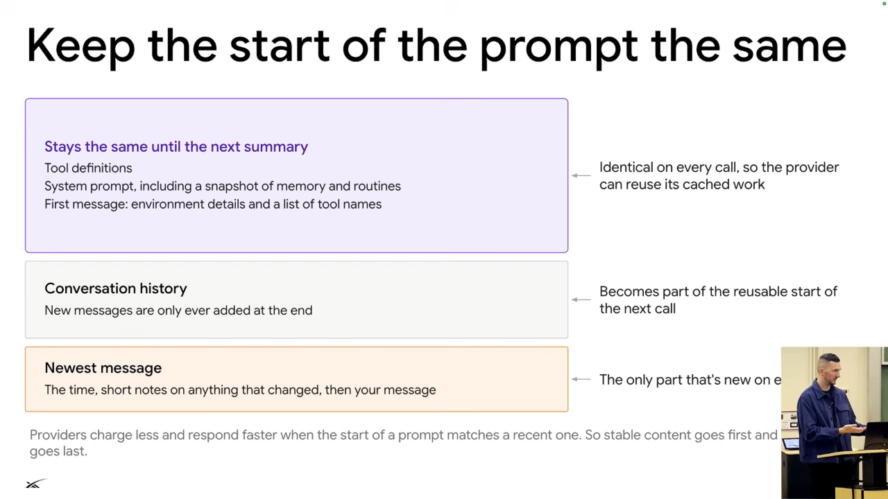
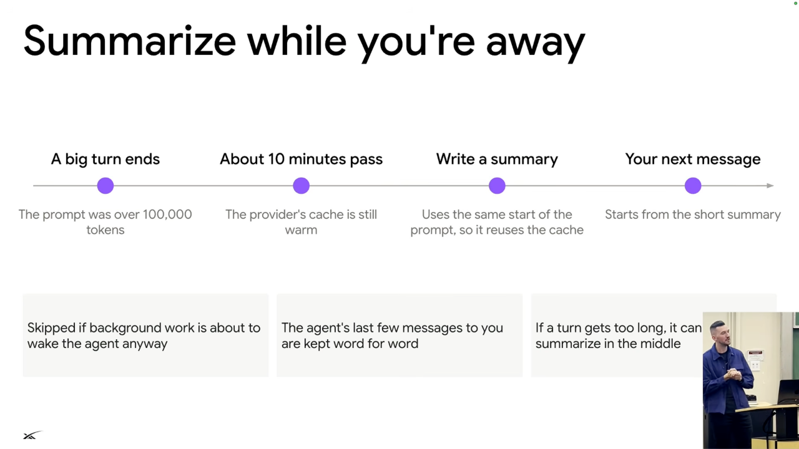

# Context engineering and prompt caching

## Keep the reusable prefix stable

*Figure 6. Stable tool definitions, system instructions, and conversation history form a reusable prefix; changing content belongs at the end. Source: leerob, [`28:13`](https://www.youtube.com/watch?v=L1OBRtfPS34&t=1693).*

- Each model call resends the conversation plus new messages. Ideally most tokens qualify for cached pricing rather than uncached pricing. [`27:47`](https://www.youtube.com/watch?v=L1OBRtfPS34&t=1667)
- Keep system prompts and tool definitions static across calls. A fixed prefix allows the newest message to be the main uncached addition. [`28:13`](https://www.youtube.com/watch?v=L1OBRtfPS34&t=1693)
- Preserve prompt section order across deployments and experiments. Lee suggests hashing sections and maintaining a fixed order so an A/B-test addition does not unnecessarily invalidate other users' caches. [`30:26`](https://www.youtube.com/watch?v=L1OBRtfPS34&t=1826) [`30:52`](https://www.youtube.com/watch?v=L1OBRtfPS34&t=1852)
- The server can prepare a prompt when the user opens the chat and starts typing, warming the cache before the message is sent. [`31:05`](https://www.youtube.com/watch?v=L1OBRtfPS34&t=1865)

## Reduce what the main agent carries

- Write long tool outputs into files and let the agent read them when needed. Delegate screenshot analysis and other context-heavy work to helpers. [`29:02`](https://www.youtube.com/watch?v=L1OBRtfPS34&t=1742) [`29:30`](https://www.youtube.com/watch?v=L1OBRtfPS34&t=1770)
- Continually trim unnecessary conversation content to improve cost, recall, and performance. Lee treats avoidable cache misses as engineering bugs and describes early Open Claw usage as exposing an unoptimized caching pattern. [`29:30`](https://www.youtube.com/watch?v=L1OBRtfPS34&t=1770) [`29:59`](https://www.youtube.com/watch?v=L1OBRtfPS34&t=1799) [`30:26`](https://www.youtube.com/watch?v=L1OBRtfPS34&t=1826)

## Compact while the cache is warm

*Figure 7. Summarize during an idle interval while the cache is warm, then resume from the shorter summary. The roughly 10-minute interval shown is an example. Source: leerob, [`32:03`](https://www.youtube.com/watch?v=L1OBRtfPS34&t=1923).*

- A finite context window eventually fills. Lee uses a 200,000-token window as an example; summarization is lossy, so retaining important details is a difficult algorithmic problem. [`31:32`](https://www.youtube.com/watch?v=L1OBRtfPS34&t=1892)
- In the example, a conversation exceeds 100,000 tokens and the user leaves. Providers may keep a cache warm for a period such as 10 or 60 minutes; these are illustrative windows, not a universal guarantee. [`32:03`](https://www.youtube.com/watch?v=L1OBRtfPS34&t=1923)
- Compact before that warm period ends. The summary is cheaper to produce using cached history, and the user can later resume with a smaller input instead of the full conversation. [`32:03`](https://www.youtube.com/watch?v=L1OBRtfPS34&t=1923) [`32:30`](https://www.youtube.com/watch?v=L1OBRtfPS34&t=1950)
