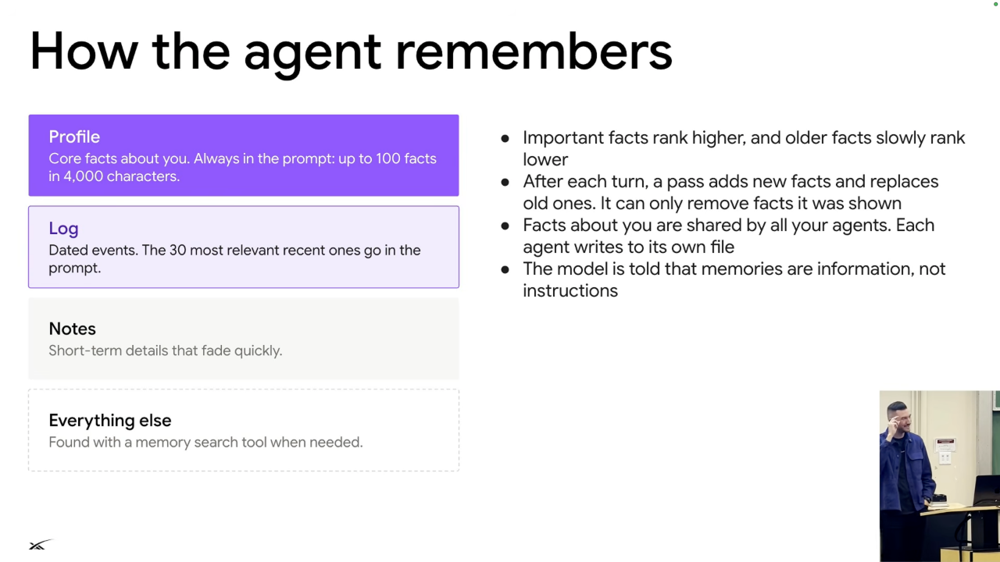

# Managing agent memory

Memory selection depends on how long information remains useful, rather than treating every remembered fact as permanent prompt content. [`32:51`](https://www.youtube.com/watch?v=L1OBRtfPS34&t=1971) [`33:17`](https://www.youtube.com/watch?v=L1OBRtfPS34&t=1997) [`34:05`](https://www.youtube.com/watch?v=L1OBRtfPS34&t=2045)

*Figure 8. Memory separates an always-included profile, recent logs, temporary notes, and information retrieved on demand. The slide also gives implementation limits omitted from the spoken explanation. Source: leerob, [`33:39`](https://www.youtube.com/watch?v=L1OBRtfPS34&t=2019).*

| Layer | What belongs there | Retention or retrieval | Source |
| --- | --- | --- | --- |
| Core user facts | Stable preferences that must hold in every reply, such as lowercase text | Include every time | [`32:51`](https://www.youtube.com/watch?v=L1OBRtfPS34&t=1971) |
| Selected relevant facts | Information important to the current conversation | Retain while relevant; remove stale facts through a garbage-collection policy | [`33:17`](https://www.youtube.com/watch?v=L1OBRtfPS34&t=1997) [`33:39`](https://www.youtube.com/watch?v=L1OBRtfPS34&t=2019) |
| Dated logs | Past conversation and work history | Keep an organized historical record | [`33:39`](https://www.youtube.com/watch?v=L1OBRtfPS34&t=2019) |
| Scratchpad | Temporary details about ongoing work | May matter for only 30 minutes or an hour, then disappear | [`34:05`](https://www.youtube.com/watch?v=L1OBRtfPS34&t=2045) |
| Other files | Information outside the active context | Retrieve later with file-reading and shell commands | [`34:05`](https://www.youtube.com/watch?v=L1OBRtfPS34&t=2045) |

## Details visible on the slide

These details are printed on the captured slide rather than stated in the transcript. [`33:39`](https://www.youtube.com/watch?v=L1OBRtfPS34&t=2019)

- The profile holds up to 100 facts within 4,000 characters. [`33:39`](https://www.youtube.com/watch?v=L1OBRtfPS34&t=2019)
- The prompt includes the 30 most relevant recent log events. [`33:39`](https://www.youtube.com/watch?v=L1OBRtfPS34&t=2019)
- Important facts rank higher; older facts gradually rank lower. A pass after each turn adds new facts and replaces old ones, and can remove only facts it was shown. [`33:39`](https://www.youtube.com/watch?v=L1OBRtfPS34&t=2019)
- User facts are shared across agents, while each agent writes to its own log file. Memories are treated as information, not instructions. [`33:39`](https://www.youtube.com/watch?v=L1OBRtfPS34&t=2019)
