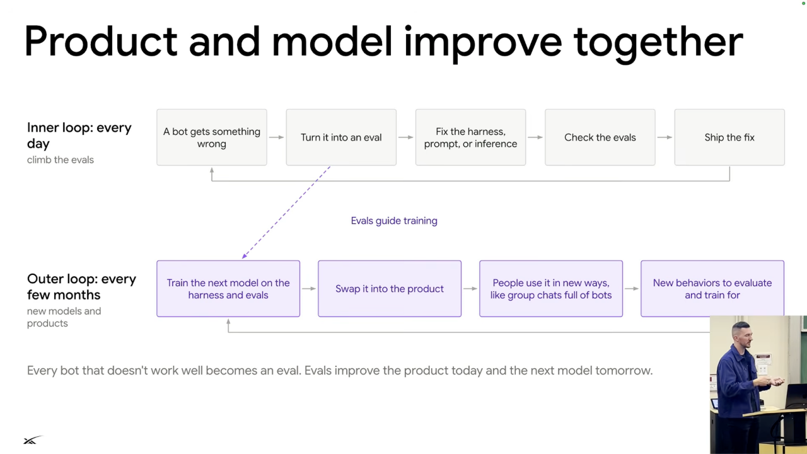

# Training and product iteration

## Train for the environment

1. Pre-training builds general knowledge from internet text and other data. [`34:29`](https://www.youtube.com/watch?v=L1OBRtfPS34&t=2069)
2. Supervised fine-tuning teaches assistant or agent behavior. Examples of the actual harness help the model learn its tools and environment. [`34:29`](https://www.youtube.com/watch?v=L1OBRtfPS34&t=2069) [`34:58`](https://www.youtube.com/watch?v=L1OBRtfPS34&t=2098)
3. Reinforcement learning can improve instruction following, skill selection among hundreds of skills, and browser interaction. [`34:58`](https://www.youtube.com/watch?v=L1OBRtfPS34&t=2098) [`35:25`](https://www.youtube.com/watch?v=L1OBRtfPS34&t=2125)

## Serve different roles differently

- Optimize the main conversational agent for low latency so it responds promptly to the user. [`35:25`](https://www.youtube.com/watch?v=L1OBRtfPS34&t=2125)
- Long-running helpers tolerate different tradeoffs. For a background task, Lee uses 10 versus 12 minutes as an example of a difference that may matter little to the user. [`35:50`](https://www.youtube.com/watch?v=L1OBRtfPS34&t=2150)

## Two improvement loops

*Figure 9. Failures become evaluations for daily product fixes and later model training. New model capabilities introduce new behaviors to evaluate. Source: leerob, [`36:38`](https://www.youtube.com/watch?v=L1OBRtfPS34&t=2198).*

- The inner loop runs frequently: capture a failure, make it an evaluation, fix the harness, prompt, code, or inference behavior, verify the fix against evaluations, and ship. An incorrect tool call is the example failure. [`36:13`](https://www.youtube.com/watch?v=L1OBRtfPS34&t=2173) [`36:38`](https://www.youtube.com/watch?v=L1OBRtfPS34&t=2198)
- The outer loop trains new models over longer cycles, using failures and evaluations to improve the behaviors the product needs before substituting the model into the product. [`36:38`](https://www.youtube.com/watch?v=L1OBRtfPS34&t=2198)
- New capabilities expose new interaction problems. Lee identifies group chats and bot-to-bot communication as emerging use cases with limited training data that need explicit behavioral training. [`37:02`](https://www.youtube.com/watch?v=L1OBRtfPS34&t=2222) [`37:25`](https://www.youtube.com/watch?v=L1OBRtfPS34&t=2245)
