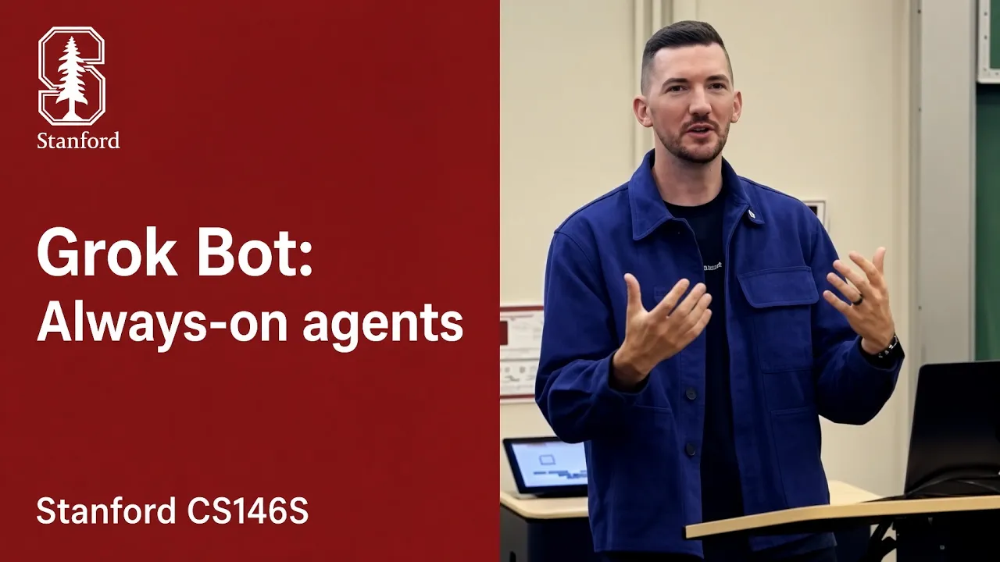

# Stanford CS146S: How always-on agents work

An educational lecture on turning a model-and-tools loop into a persistent, proactive agent. Lee explains the server and cloud-computer architecture, crash recovery, tool selection, context and memory management, and the evaluation loops used to improve the product. [`2:08`](https://www.youtube.com/watch?v=L1OBRtfPS34&t=128)

## Topics

1. [Introduction to always-on agents](./01-introduction.md)
2. [The evolution of AI development](./02-evolution-of-ai-development.md)
3. [Model capabilities, files, and skills](./03-model-capabilities.md)
4. [Architecture and agent lifecycle](./04-architecture.md)
5. [Server mechanics and durable execution](./05-server-mechanics.md)
6. [Building the agent harness](./06-agent-harness.md)
7. [Context engineering and prompt caching](./07-context-engineering.md)
8. [Managing agent memory](./08-agent-memory.md)
9. [Training and product iteration](./09-training-and-iteration.md)
10. [Future outlook and open problems](./10-future-outlook.md)

## Key takeaways

- Always-on agents can sleep between events. Persistence comes from saving state and restoring it when a message or background event wakes the agent. [`10:05`](https://www.youtube.com/watch?v=L1OBRtfPS34&t=605) [`10:58`](https://www.youtube.com/watch?v=L1OBRtfPS34&t=658)
- Keep the agent loop on a server separate from its Linux VM so the computer can shut down or be rebuilt independently. [`14:30`](https://www.youtube.com/watch?v=L1OBRtfPS34&t=870) [`15:04`](https://www.youtube.com/watch?v=L1OBRtfPS34&t=904)
- The implementation uses Temporal durable workflows to resume after infrastructure failures; helpers also run as durable workflows. [`16:42`](https://www.youtube.com/watch?v=L1OBRtfPS34&t=1002) [`17:06`](https://www.youtube.com/watch?v=L1OBRtfPS34&t=1026) [`24:34`](https://www.youtube.com/watch?v=L1OBRtfPS34&t=1474)
- Load tool details on demand, delegate verbose work to helpers, and return results to the main agent. This conserves its finite context window rather than creating literal infinite context. [`20:48`](https://www.youtube.com/watch?v=L1OBRtfPS34&t=1248) [`23:30`](https://www.youtube.com/watch?v=L1OBRtfPS34&t=1410) [`24:07`](https://www.youtube.com/watch?v=L1OBRtfPS34&t=1447)
- Stable prompt prefixes preserve cached tokens. Compacting a long conversation while its cache is still warm reduces the cost of summarization and later turns. [`28:13`](https://www.youtube.com/watch?v=L1OBRtfPS34&t=1693) [`32:03`](https://www.youtube.com/watch?v=L1OBRtfPS34&t=1923) [`32:30`](https://www.youtube.com/watch?v=L1OBRtfPS34&t=1950)
- Memory has different lifetimes: persistent user facts, dated activity logs, temporary scratchpad notes, and files retrieved when needed. [`32:51`](https://www.youtube.com/watch?v=L1OBRtfPS34&t=1971) [`33:39`](https://www.youtube.com/watch?v=L1OBRtfPS34&t=2019) [`34:05`](https://www.youtube.com/watch?v=L1OBRtfPS34&t=2045)
- Product improvement has two loops: turn failures into evaluations and ship verified fixes frequently, then use those failures and evaluations to improve later models. [`36:13`](https://www.youtube.com/watch?v=L1OBRtfPS34&t=2173) [`36:38`](https://www.youtube.com/watch?v=L1OBRtfPS34&t=2198)
