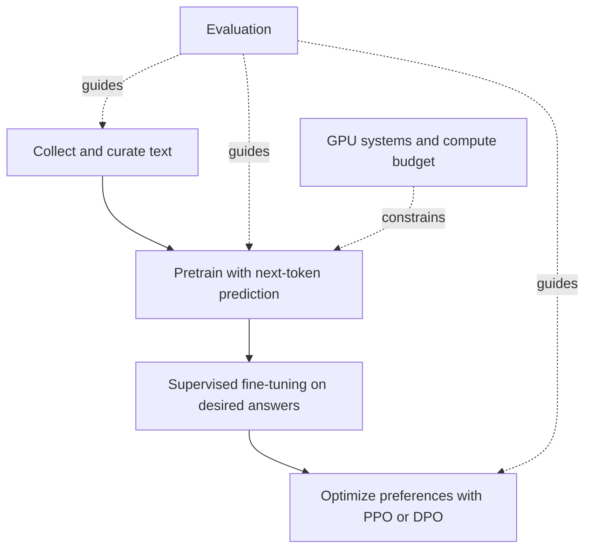

# Lecture roadmap

- This is an educational overview of building LLMs, illustrated by ChatGPT, Claude, Gemini, and Llama. It treats the transformer as a black box rather than teaching its architecture. [`0:21`](https://www.youtube.com/watch?v=9vM4p9NN0Ts&t=21) [`1:57`](https://www.youtube.com/watch?v=9vM4p9NN0Ts&t=117)
- Five components determine an LLM training project: architecture, loss and training algorithm, data, evaluation, and systems. Systems make very large models practical on available hardware. [`0:53`](https://www.youtube.com/watch?v=9vM4p9NN0Ts&t=53) [`1:20`](https://www.youtube.com/watch?v=9vM4p9NN0Ts&t=80) [`1:33`](https://www.youtube.com/watch?v=9vM4p9NN0Ts&t=93)
- The lecturer argues that data, evaluation, and systems deserve more attention than they receive in academic modeling research because they dominate practical development. This is the lecture's organizing position. [`2:17`](https://www.youtube.com/watch?v=9vM4p9NN0Ts&t=137) [`2:37`](https://www.youtube.com/watch?v=9vM4p9NN0Ts&t=157)
- Pretraining learns a broad language distribution from large text collections. Post-training adapts that model into an assistant that follows instructions and responds in the desired manner. [`3:02`](https://www.youtube.com/watch?v=9vM4p9NN0Ts&t=182) [`3:18`](https://www.youtube.com/watch?v=9vM4p9NN0Ts&t=198)

The diagram combines the lecture's data pipeline, pretraining objective, and post-training stages. [`28:38`](https://www.youtube.com/watch?v=9vM4p9NN0Ts&t=1718) [`9:30`](https://www.youtube.com/watch?v=9vM4p9NN0Ts&t=570) [`1:18:34`](https://www.youtube.com/watch?v=9vM4p9NN0Ts&t=4714) [`1:21:08`](https://www.youtube.com/watch?v=9vM4p9NN0Ts&t=4868)
