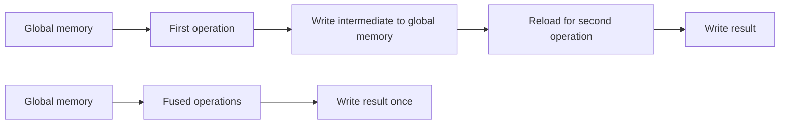

# GPU systems and optimization

## Keep compute supplied with data

- More GPUs are expensive and can be scarce; communication across devices also limits scaling. Resource allocation and pipeline efficiency therefore matter alongside device count. [`1:37:14`](https://www.youtube.com/watch?v=9vM4p9NN0Ts&t=5834) [`1:37:31`](https://www.youtube.com/watch?v=9vM4p9NN0Ts&t=5851)
- GPUs emphasize parallel throughput and fast matrix multiplication. CPUs emphasize latency. The lecture uses this distinction to explain why accelerator-friendly operations matter. [`1:37:49`](https://www.youtube.com/watch?v=9vM4p9NN0Ts&t=5869) [`1:38:11`](https://www.youtube.com/watch?v=9vM4p9NN0Ts&t=5891) [`1:38:30`](https://www.youtube.com/watch?v=9vM4p9NN0Ts&t=5910)
- Compute throughput has improved faster than memory and communication, so data movement can leave arithmetic units idle. Nearby memory is smaller and faster; farther memory is larger and slower. [`1:38:30`](https://www.youtube.com/watch?v=9vM4p9NN0Ts&t=5910) [`1:38:50`](https://www.youtube.com/watch?v=9vM4p9NN0Ts&t=5930) [`1:39:06`](https://www.youtube.com/watch?v=9vM4p9NN0Ts&t=5946)
- Model FLOP utilization compares observed model throughput with theoretical hardware peak throughput. The lecturer describes about 50% as a strong result and cites roughly 45% for Llama. These are lecture examples, not a measured result from these notes. [`1:39:24`](https://www.youtube.com/watch?v=9vM4p9NN0Ts&t=5964) [`1:39:45`](https://www.youtube.com/watch?v=9vM4p9NN0Ts&t=5985)

## Mixed precision

1. Reduce the number of bits used in computation to reduce memory use and communication traffic. [`1:40:04`](https://www.youtube.com/watch?v=9vM4p9NN0Ts&t=6004)
2. Use 16-bit values for fast matrix operations while retaining higher precision where needed. The lecture calls this automatic mixed precision. [`1:40:33`](https://www.youtube.com/watch?v=9vM4p9NN0Ts&t=6033) [`1:40:54`](https://www.youtube.com/watch?v=9vM4p9NN0Ts&t=6054)
3. In the simplified scheme presented, retain 32-bit master weights and apply updates in 32-bit precision so small learning-rate updates are not lost to rounding. [`1:41:10`](https://www.youtube.com/watch?v=9vM4p9NN0Ts&t=6070) [`1:41:25`](https://www.youtube.com/watch?v=9vM4p9NN0Ts&t=6085)

## Operator fusion

- In the eager-execution example, computing `cos(x)` and then another cosine can write and reload the intermediate result through GPU global memory. This adds memory traffic even though the arithmetic is small. [`1:41:40`](https://www.youtube.com/watch?v=9vM4p9NN0Ts&t=6100) [`1:42:00`](https://www.youtube.com/watch?v=9vM4p9NN0Ts&t=6120) [`1:42:15`](https://www.youtube.com/watch?v=9vM4p9NN0Ts&t=6135)
- A fused kernel performs compatible operations together before writing the result back, reducing intermediate global-memory transfers. [`1:42:28`](https://www.youtube.com/watch?v=9vM4p9NN0Ts&t=6148)
- The lecturer recommends `torch.compile` as a way to obtain compiler optimizations such as fusion and cites approximately 2× speed as an illustrative expectation. No workload or benchmark procedure is supplied, so it is not a guaranteed speedup. [`1:42:28`](https://www.youtube.com/watch?v=9vM4p9NN0Ts&t=6148) [`1:42:48`](https://www.youtube.com/watch?v=9vM4p9NN0Ts&t=6168)

The two paths contrast the lecture's unfused example with its fused alternative. [`1:42:00`](https://www.youtube.com/watch?v=9vM4p9NN0Ts&t=6120) [`1:42:15`](https://www.youtube.com/watch?v=9vM4p9NN0Ts&t=6135) [`1:42:28`](https://www.youtube.com/watch?v=9vM4p9NN0Ts&t=6148)
