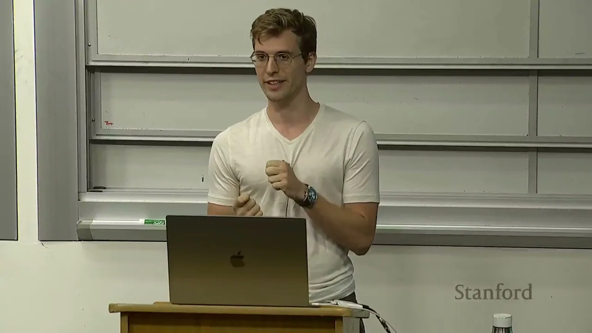

# Stanford CS229 I Machine Learning I Building Large Language Models (LLMs)

An educational lecture on building LLMs, from next-token pretraining to assistants trained on demonstrations and preferences. It emphasizes data preparation, evaluation, scaling decisions, and efficient GPU use, with examples from Llama, Alpaca, and AlpacaEval. Transformer architecture is assumed rather than taught. [`2:00`](https://www.youtube.com/watch?v=9vM4p9NN0Ts&t=120) [`2:37`](https://www.youtube.com/watch?v=9vM4p9NN0Ts&t=157) [`3:18`](https://www.youtube.com/watch?v=9vM4p9NN0Ts&t=198) [`1:43:07`](https://www.youtube.com/watch?v=9vM4p9NN0Ts&t=6187)

[Watch the video](https://www.youtube.com/watch?v=9vM4p9NN0Ts) · Stanford Online · 1:44:31 · English

## Topic breakdown

1. [Lecture roadmap](./01-lecture-roadmap.md)
2. [Language modeling and training](./02-language-modeling-and-training.md)
3. [Tokenization](./03-tokenization.md)
4. [Pretraining evaluation](./04-pretraining-evaluation.md)
5. [Pretraining data](./05-pretraining-data.md)
6. [Scaling laws and resource allocation](./06-scaling-laws-and-resource-allocation.md)
7. [Training cost estimates](./07-training-cost-estimates.md)
8. [Supervised fine-tuning](./08-supervised-fine-tuning.md)
9. [Preference learning, PPO, and DPO](./09-preference-learning-ppo-and-dpo.md)
10. [Preference data and bias](./10-preference-data-and-bias.md)
11. [Evaluating assistants](./11-evaluating-assistants.md)
12. [GPU systems and optimization](./12-gpu-systems-and-optimization.md)
13. [Scope and further study](./13-scope-and-further-study.md)

The [original transcript](./transcript.md) is preserved verbatim. Numerical results below describe the lecture's examples and estimates, not present-day product specifications.

## Key takeaways

- Autoregressive next-token training uses cross-entropy; minimizing it maximizes the likelihood of the training text. Generation then samples tokens sequentially. [`5:40`](https://www.youtube.com/watch?v=9vM4p9NN0Ts&t=340) [`6:12`](https://www.youtube.com/watch?v=9vM4p9NN0Ts&t=372) [`10:08`](https://www.youtube.com/watch?v=9vM4p9NN0Ts&t=608)
- Useful pretraining data requires extraction, filtering, deduplication, quality assessment, and domain balancing. Raw crawls are not ready-made training corpora. [`30:40`](https://www.youtube.com/watch?v=9vM4p9NN0Ts&t=1840) [`31:48`](https://www.youtube.com/watch?v=9vM4p9NN0Ts&t=1908) [`32:28`](https://www.youtube.com/watch?v=9vM4p9NN0Ts&t=1948) [`33:38`](https://www.youtube.com/watch?v=9vM4p9NN0Ts&t=2018) [`34:41`](https://www.youtube.com/watch?v=9vM4p9NN0Ts&t=2081)
- Benchmark procedure can change the apparent result substantially: the lecture reports Llama-65B at 63.7% versus 48.8% under different evaluation setups. [`26:17`](https://www.youtube.com/watch?v=9vM4p9NN0Ts&t=1577)
- Scaling experiments on smaller models can guide a large training run. Chinchilla's cited training-optimal ratio is about 20 tokens per parameter; inference-aware choices can favor smaller models trained on more tokens. [`46:09`](https://www.youtube.com/watch?v=9vM4p9NN0Ts&t=2769) [`51:23`](https://www.youtube.com/watch?v=9vM4p9NN0Ts&t=3083) [`52:17`](https://www.youtube.com/watch?v=9vM4p9NN0Ts&t=3137)
- The Llama 3 405B cost example estimates about 26 million GPU-hours and $52 million in rental-equivalent compute, illustrating the scale of a single large run. [`56:46`](https://www.youtube.com/watch?v=9vM4p9NN0Ts&t=3406) [`57:36`](https://www.youtube.com/watch?v=9vM4p9NN0Ts&t=3456)
- Alpaca converted 175 seed examples into 52,000 synthetic instruction examples and fine-tuned Llama 7B, demonstrating a practical route to instruction tuning with limited human writing. [`1:04:11`](https://www.youtube.com/watch?v=9vM4p9NN0Ts&t=3851) [`1:04:27`](https://www.youtube.com/watch?v=9vM4p9NN0Ts&t=3867)
- In the presented AlpacaFarm comparison, preference optimization improves over SFT, while DPO matches PPO's reported performance with a simpler training procedure. [`1:21:08`](https://www.youtube.com/watch?v=9vM4p9NN0Ts&t=4868) [`1:23:22`](https://www.youtube.com/watch?v=9vM4p9NN0Ts&t=5002)
- Length alone can distort preference rankings: GPT-4's win rate against the baseline moves from 50% to 64.4% when prompted for verbosity and to 20% when prompted for concision. [`1:32:50`](https://www.youtube.com/watch?v=9vM4p9NN0Ts&t=5570) [`1:33:06`](https://www.youtube.com/watch?v=9vM4p9NN0Ts&t=5586)
- Mixed precision and operator fusion improve GPU efficiency by reducing memory and communication demands, rather than relying only on adding hardware. [`1:40:04`](https://www.youtube.com/watch?v=9vM4p9NN0Ts&t=6004) [`1:41:10`](https://www.youtube.com/watch?v=9vM4p9NN0Ts&t=6070) [`1:42:28`](https://www.youtube.com/watch?v=9vM4p9NN0Ts&t=6148)
