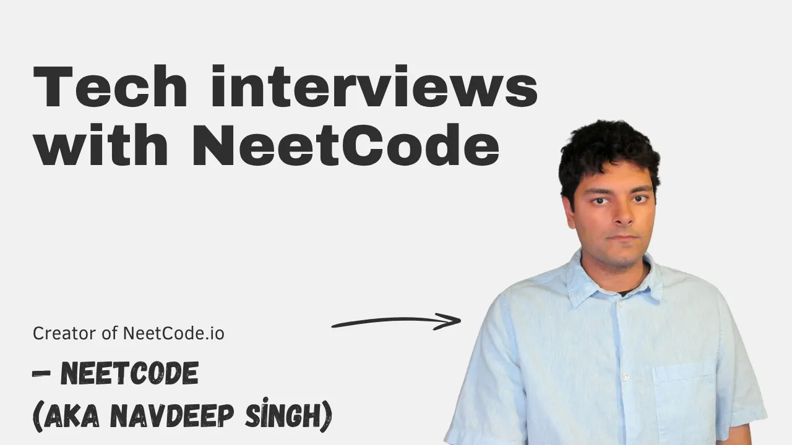
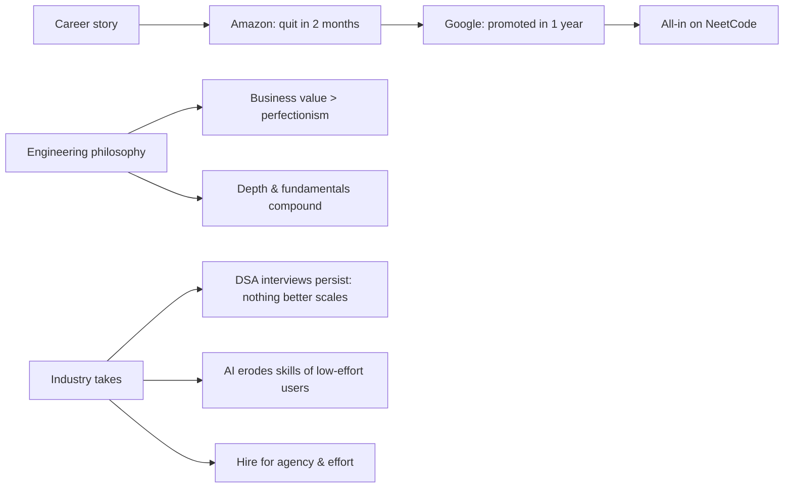

# Tech interviews with NeetCode

*The Pragmatic Engineer podcast · 1:29:56 · [Watch on YouTube](https://www.youtube.com/watch?v=xafwfGVBxos)*

Gergely Orosz interviews Naveed "Navi" Singh, creator of NeetCode, the coding interview prep platform. The conversation is part career story (quitting Amazon after two months, a fast Google promotion, leaving to go all-in on NeetCode) and part engineering philosophy: why DSA interviews refuse to die, why deliberately not fixing a production bug can be the right call, what interview prep actually teaches, and a series of hot takes on AI skill erosion, hiring for agency over credentials, and why effort is becoming the scarce resource now that AI makes everything else cheap.

## Topics

1. [Why coding interviews haven't died](01-why-coding-interviews-persist.md)
2. [Getting into tech](02-getting-into-tech.md)
3. [Why Navi isn't a fan of the CAP theorem](03-cap-theorem-critique.md)
4. [Quitting Amazon after two months](04-quitting-amazon.md)
5. [Google vs Amazon](05-google-vs-amazon.md)
6. [The origins of NeetCode](06-origins-of-neetcode.md)
7. [Leaving Google to go all in on NeetCode](07-leaving-google-going-all-in.md)
8. [Why Navi doesn't fix every bug](08-why-navi-doesnt-fix-every-bug.md)
9. [The value of coding interview prep](09-value-of-interview-prep.md)
10. [Systems thinking and domain expertise](10-systems-thinking-and-domain-expertise.md)
11. [Hiring at Big Tech (and elsewhere)](11-hiring-at-big-tech.md)
12. [Tech stack at NeetCode](12-tech-stack-at-neetcode.md)
13. [The NeetCode redesign contest](13-redesign-contest.md)
14. [The future of software engineers](14-future-of-software-engineers.md)
15. [Hot takes: AGI, AI skill erosion, personality traits](15-hot-takes.md)
16. ["Maybe some people should just give up", standout advice, and book recommendation](16-give-up-standout-advice-books.md)

## Key takeaways

- DSA interviews persist not because they predict job performance (they don't) but because companies have no better scalable alternative — Amazon's internal studies showed hiring outcomes are nearly impossible to predict regardless of interview data [`4:46`](https://www.youtube.com/watch?v=xafwfGVBxos&t=286), [`1:29:05`](https://www.youtube.com/watch?v=xafwfGVBxos&t=5345)
- Google has largely returned to in-person on-site interviews, killing the remote-interview cheating tools that flourished over the last 5–6 years [`48:58`](https://www.youtube.com/watch?v=xafwfGVBxos&t=2938)
- Navi replaced a $3,000/month code execution SaaS with an AI-assisted rewrite built in 2–3 days that costs ~$200/month — and deliberately leaves its memory-leak bug unfixed, running ~4 redundant instances instead, because fixing it would take longer than building it and would only save a couple hundred dollars [`32:47`](https://www.youtube.com/watch?v=xafwfGVBxos&t=1967), [`33:14`](https://www.youtube.com/watch?v=xafwfGVBxos&t=1994)
- PACELC supersedes the CAP theorem: it covers the availability/consistency choice under partition *plus* the latency/consistency trade-off without one — Navi sees no reason to keep teaching CAP [`11:09`](https://www.youtube.com/watch?v=xafwfGVBxos&t=669), [`11:27`](https://www.youtube.com/watch?v=xafwfGVBxos&t=687)
- Interview prep's real transferable value is thinking, communication, and trade-off reasoning — it's how Navi got promoted at Google in about a year despite subpar raw coding experience [`40:35`](https://www.youtube.com/watch?v=xafwfGVBxos&t=2435), [`21:25`](https://www.youtube.com/watch?v=xafwfGVBxos&t=1285)
- The $2,500 redesign contest yielded almost exclusively AI-generated submissions whose authors couldn't explain their own design choices — evidence that prompting without understanding produces indefensible work [`57:57`](https://www.youtube.com/watch?v=xafwfGVBxos&t=3477), [`58:44`](https://www.youtube.com/watch?v=xafwfGVBxos&t=3524)
- Navi's best hire ever is an ungraduated student who out-performs experienced big-tech candidates purely on agency: given an unknown domain, they learn everything about it within a week [`1:15:30`](https://www.youtube.com/watch?v=xafwfGVBxos&t=4530), [`1:15:51`](https://www.youtube.com/watch?v=xafwfGVBxos&t=4551)
- Every past abstraction leap (cloud, high-level languages) failed to reduce programmer headcount, and Navi doesn't expect AI to cause a programmer extinction either — though AI subsidies running out may force companies to cut back on AI-assisted development [`1:06:11`](https://www.youtube.com/watch?v=xafwfGVBxos&t=3971), [`1:08:43`](https://www.youtube.com/watch?v=xafwfGVBxos&t=4123)
- AI didn't repeal the speed/quality trade-off: Anthropic shipped so fast it took a month+ and public pressure to acknowledge regressions, and OpenAI shut down Sora's social network to refocus on coding [`55:37`](https://www.youtube.com/watch?v=xafwfGVBxos&t=3337), [`56:51`](https://www.youtube.com/watch?v=xafwfGVBxos&t=3411)
- In 2026 it's never been easier to build things, but that makes it ~10x harder to build *value* — shipping features nobody wants clutters products and can make them worse [`54:30`](https://www.youtube.com/watch?v=xafwfGVBxos&t=3270), [`54:58`](https://www.youtube.com/watch?v=xafwfGVBxos&t=3298)
- Effort is the emerging differentiator: anyone can prompt a design or an answer, but "what you cannot prompt is caring and your ability to defend your choices" [`1:29:05`](https://www.youtube.com/watch?v=xafwfGVBxos&t=5345)
