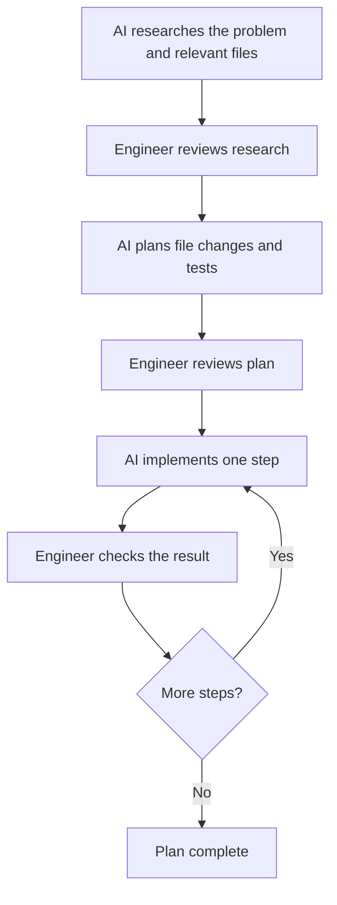

# Direct AI coding with research, plan, and implement

## Replace vague iteration with explicit direction

- Khader contrasts directing AI with repeatedly asking it to "build me an app" and "make it better." Without a clear target, the model may make superficial changes while the user expects it to infer unstated requirements. [`9:02`](https://www.youtube.com/watch?v=j7vSphawXyY&t=542) [`9:25`](https://www.youtube.com/watch?v=j7vSphawXyY&t=565)
- RPI means research, plan, and implement. The engineer reviews the work between stages and during implementation. [`9:49`](https://www.youtube.com/watch?v=j7vSphawXyY&t=589) [`10:17`](https://www.youtube.com/watch?v=j7vSphawXyY&t=617) [`10:42`](https://www.youtube.com/watch?v=j7vSphawXyY&t=642)

## 1. Research the problem

- Ask AI to investigate before writing code. For an authentication task, Khader suggests researching user handling, security protocols, and databases. [`9:49`](https://www.youtube.com/watch?v=j7vSphawXyY&t=589)
- Expected output: relevant files and a short summary of how the system works. Review these findings before planning changes. [`10:17`](https://www.youtube.com/watch?v=j7vSphawXyY&t=617)

## 2. Plan the changes

- Ask AI to specify which files must change, what it will add to each file, and how it will test every change. [`10:17`](https://www.youtube.com/watch?v=j7vSphawXyY&t=617)
- Review the plan before allowing implementation to begin. [`10:17`](https://www.youtube.com/watch?v=j7vSphawXyY&t=617)

## 3. Implement incrementally

- Have AI execute one step, inspect the result, then proceed to the next step. Repeat until the plan is complete. [`10:42`](https://www.youtube.com/watch?v=j7vSphawXyY&t=642)
- The engineer retains responsibility for direction and checks throughout the process. Khader presents this as a better way to use AI as a thought partner. [`9:49`](https://www.youtube.com/watch?v=j7vSphawXyY&t=589) [`10:42`](https://www.youtube.com/watch?v=j7vSphawXyY&t=642)

The review checkpoints follow Khader's explanation of RPI. [`10:17`](https://www.youtube.com/watch?v=j7vSphawXyY&t=617) [`10:42`](https://www.youtube.com/watch?v=j7vSphawXyY&t=642)
