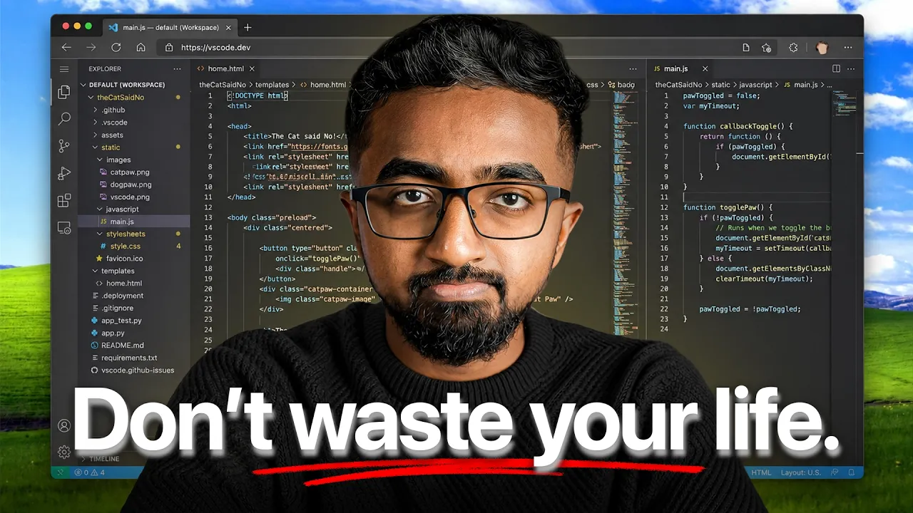

# The Art of Winning in Tech

Sajjaad Khader's 11:30 educational career-advice video presents four rules for progressing in tech: learn from more experienced people, share your work, automate repetitive tasks, and direct AI through research, planning, and implementation. It uses personal anecdotes and an entrepreneur's reported results, with a separate Abacus AI promotional segment. [`0:00`](https://www.youtube.com/watch?v=j7vSphawXyY&t=0) [`4:53`](https://www.youtube.com/watch?v=j7vSphawXyY&t=293)

## Topic breakdown

1. [Introduction: the four-rule career framework](01-introduction.md)
2. [Learn from experts: turn knowledge gaps into a curriculum](02-learn-from-experts.md)
3. [Build in public: develop an audience and earn trust](03-build-in-public.md)
4. [Abacus AI Agent: the promoted app-building example](04-abacus-ai-agent.md)
5. [Automate repetitive work: reduce the speed tax](05-automate-with-ai-tools.md)
6. [Direct AI coding with research, plan, and implement](06-ai-coding-workflow.md)

Source: [video](https://www.youtube.com/watch?v=j7vSphawXyY) · [verbatim transcript](transcript.md)

## Key takeaways

- Khader turned an intimidating conference into a learning curriculum by recording unfamiliar terms, researching them afterward, and building projects. [`1:23`](https://www.youtube.com/watch?v=j7vSphawXyY&t=83) [`1:46`](https://www.youtube.com/watch?v=j7vSphawXyY&t=106)
- In Khader's account, Mark Lou built an audience of about 35,000 before launching ShipFast, which earned $6,000 in two days, $40,000 in its first month, and later exceeded $1 million in total revenue. The example connects public work with an existing customer base. [`3:34`](https://www.youtube.com/watch?v=j7vSphawXyY&t=214)
- Automation applies beyond code generation. Khader reports typing at 57 words per minute versus dictating at about 166 with an AI tool, roughly three times the text-entry rate. [`7:31`](https://www.youtube.com/watch?v=j7vSphawXyY&t=451)
- The RPI workflow keeps the engineer responsible for direction: review AI research, review a file-by-file plan with tests, then check implementation one step at a time. [`9:49`](https://www.youtube.com/watch?v=j7vSphawXyY&t=589) [`10:17`](https://www.youtube.com/watch?v=j7vSphawXyY&t=617) [`10:42`](https://www.youtube.com/watch?v=j7vSphawXyY&t=642)
