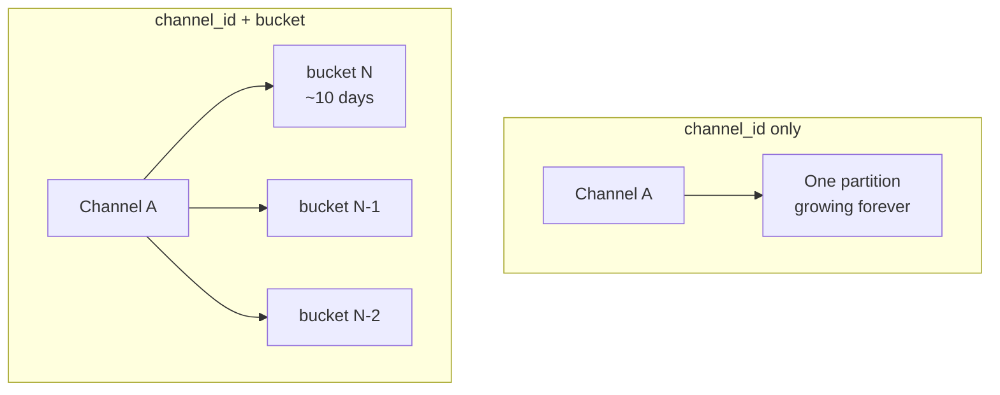

# 04 — The Partition Key, Buckets and Snowflake IDs

The design decision here looked perfectly reasonable at the time and became one of Discord's biggest scaling headaches years later ([`5:10`](https://www.youtube.com/watch?v=X4iAQkjtx5k&t=310)).

## What a partition key is

- In Cassandra, data is spread across many machines and the **partition key decides which machine your data lands on** ([`5:26`](https://www.youtube.com/watch?v=X4iAQkjtx5k&t=326)).
- Same partition key → same home: rows share a node ([`5:26`](https://www.youtube.com/watch?v=X4iAQkjtx5k&t=326)).
- Pick well → data spread nicely, fast reads. Pick badly → **traffic jam on one machine while others sit idle** ([`5:43`](https://www.youtube.com/watch?v=X4iAQkjtx5k&t=343)).

## First instinct: channel ID

- Use `channel_id` as the partition key so all messages of a channel live together — intuitive, since opening a channel means wanting its messages ([`5:43`](https://www.youtube.com/watch?v=X4iAQkjtx5k&t=343)).
- **The catch:** some channels never die. A big public channel collects messages for years, so its partition grows without limit, and a giant partition becomes a heavy, slow thing the database struggles to manage ([`6:05`](https://www.youtube.com/watch?v=X4iAQkjtx5k&t=365), [`6:20`](https://www.youtube.com/watch?v=X4iAQkjtx5k&t=380)).

## The fix: channel ID + time bucket

- Partition key became **`channel_id` + `bucket`**, where a bucket is a time window of roughly **10 days** of messages ([`6:20`](https://www.youtube.com/watch?v=X4iAQkjtx5k&t=380)).
- Effects ([`6:35`](https://www.youtube.com/watch?v=X4iAQkjtx5k&t=395)):
  - A **fresh partition every 10 days** instead of one endless partition per channel.
  - Each partition stays a sensible size.
  - Messages stored newest-first, sorted by time → fetching recent messages is fast.
  - Scrolling history = walking back through buckets one by one.

## Snowflake IDs

- Discord used **snowflake IDs** for messages: the creation time is **baked into the ID itself** ([`6:35`](https://www.youtube.com/watch?v=X4iAQkjtx5k&t=395), [`6:59`](https://www.youtube.com/watch?v=X4iAQkjtx5k&t=419)).
- That makes sorting by time and jumping to the right bucket natural — no extra lookup needed ([`7:06`](https://www.youtube.com/watch?v=X4iAQkjtx5k&t=426)).

## Cassandra's golden era — the numbers

Results of this design ([`7:06`](https://www.youtube.com/watch?v=X4iAQkjtx5k&t=426)):

| Metric | Value (early 2017) |
|---|---|
| Writes | under **10 ms** |
| Reads | under **5 ms** |
| Cluster size | **12 machines** |
| Throughput | over **120 million messages/day** |
| Team maintaining it | **4 engineers** |

A very efficient system — but not the happy ending ([`7:29`](https://www.youtube.com/watch?v=X4iAQkjtx5k&t=449)).
