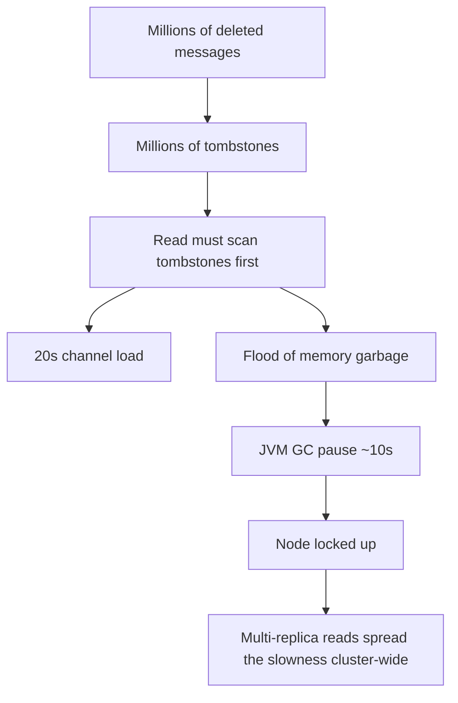

# 05 — The 20-Second Bug: Tombstones and the Garbage Collector

The 20-second load was **not a bug in Discord's code** — it was Cassandra doing exactly what it was designed to do ([`7:33`](https://www.youtube.com/watch?v=X4iAQkjtx5k&t=453)).

## How Cassandra deletes: it doesn't (right away)

- Deleting a row does not erase it on the spot. Cassandra writes a marker saying "this is deleted" — a **tombstone** ([`7:53`](https://www.youtube.com/watch?v=X4iAQkjtx5k&t=473)).
- Real cleanup happens much later in a background process; until then the tombstone just sits there ([`7:53`](https://www.youtube.com/watch?v=X4iAQkjtx5k&t=473)).

## Why it exploded

- In that specific channel, users had deleted **millions of messages** → **millions of tombstones** piled up ([`8:11`](https://www.youtube.com/watch?v=X4iAQkjtx5k&t=491)).
- To find the surviving messages, Cassandra had to **read through all of them first** ([`8:11`](https://www.youtube.com/watch?v=X4iAQkjtx5k&t=491)).
- Analogy: finding one book on a shelf after picking up millions of "this book is gone" notes ([`8:34`](https://www.youtube.com/watch?v=X4iAQkjtx5k&t=514)).
- That is the 20 seconds — and chewing through tombstones created a **flood of memory garbage** ([`8:34`](https://www.youtube.com/watch?v=X4iAQkjtx5k&t=514)).

## The garbage collector amplifier

- Cassandra runs on the **JVM**, which cleans unused memory automatically via **garbage collection** ([`8:51`](https://www.youtube.com/watch?v=X4iAQkjtx5k&t=531)).
- To clean properly the JVM must **pause the whole program** — here, pauses lasted **10 full seconds**, effectively locking the node ([`8:51`](https://www.youtube.com/watch?v=X4iAQkjtx5k&t=531), [`9:13`](https://www.youtube.com/watch?v=X4iAQkjtx5k&t=553)).
- Because Discord reads from **more than one replica** for safety, **one sick node slowed requests across the system** — one bad channel could hurt everyone ([`9:13`](https://www.youtube.com/watch?v=X4iAQkjtx5k&t=553)).

## The patches Discord applied

Three fixes, all mitigations rather than cures ([`9:13`](https://www.youtube.com/watch?v=X4iAQkjtx5k&t=553)):

1. Made tombstones get **cleaned up faster**.
2. Changed their code to **skip empty buckets** instead of reading through them.
3. Stopped **writing unnecessary empty values** that created tombstones in the first place.

**Pattern to notice:** the garbage collector caused the freeze — it becomes the central problem of the next chapters ([`9:39`](https://www.youtube.com/watch?v=X4iAQkjtx5k&t=579), [`9:41`](https://www.youtube.com/watch?v=X4iAQkjtx5k&t=581)).
