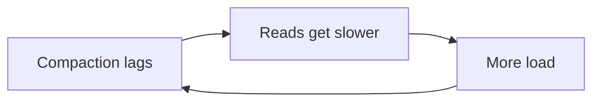

# 06 — Five Years of Scaling Pain (2017–2022)

## Growth in numbers

Between **2017 and 2022** ([`9:41`](https://www.youtube.com/watch?v=X4iAQkjtx5k&t=581)):

- Cluster grew from **12 machines to 177**.
- Messages went from **billions to trillions**.
- At that scale, every small weakness became a big painful problem.

## Problem 1 — Hot partitions

- Came straight out of the clever bucket design: all messages for a `channel + bucket` live on the **same machines** ([`10:08`](https://www.youtube.com/watch?v=X4iAQkjtx5k&t=608)).
- Picture a channel in a server with **200,000 members**: when something big happens, everyone types at once ([`10:08`](https://www.youtube.com/watch?v=X4iAQkjtx5k&t=608)).
- All that traffic hammers the same few machines while the rest stay relatively free — a **hot partition**, a traffic jam on one road while the rest of the city is empty ([`10:26`](https://www.youtube.com/watch?v=X4iAQkjtx5k&t=626)).
- Because reads span replicas, that overload **rippled out and slowed everyone else** ([`10:26`](https://www.youtube.com/watch?v=X4iAQkjtx5k&t=626)).

## Problem 2 — The garbage collector, again

- At this scale **JVM pauses became a constant headache**; the team spent huge amounts of time tuning settings trying to control it ([`10:26`](https://www.youtube.com/watch?v=X4iAQkjtx5k&t=626)).
- Sometimes a node froze so badly that an engineer had to **manually restart it and nurse it back to health — at night, on a weekend** ([`10:54`](https://www.youtube.com/watch?v=X4iAQkjtx5k&t=654)).
- The real cost: actual engineers getting paged because a machine could not clean up its own memory ([`10:54`](https://www.youtube.com/watch?v=X4iAQkjtx5k&t=654)).

## Problem 3 — Compaction falling behind, and the "gossip dance"

- **Compaction** = Cassandra constantly writes data in small pieces and periodically merges them to keep reads fast ([`11:13`](https://www.youtube.com/watch?v=X4iAQkjtx5k&t=673)).
- Discord kept falling behind, creating a **self-feeding loop**: compaction lags → reads slower → more load → compaction falls further behind ([`11:13`](https://www.youtube.com/watch?v=X4iAQkjtx5k&t=673)).

- Workaround nicknamed the **gossip dance**: quietly pull a node out of rotation so it could catch up on compaction in peace, slip it back in, then move to the next one ([`11:36`](https://www.youtube.com/watch?v=X4iAQkjtx5k&t=696)).
- A hand-built routine just to keep the system breathing — a sign the system is fighting you ([`11:36`](https://www.youtube.com/watch?v=X4iAQkjtx5k&t=696)).

## The number that summed it up

- **Tail latency** (the slowest reads users actually felt) swung anywhere from **40 to over 120 ms** with no consistency ([`11:36`](https://www.youtube.com/watch?v=X4iAQkjtx5k&t=696)).
- The system was not exactly failing, but it had become **high toil**: constant paging, expensive maintenance, weekend firefighting ([`11:36`](https://www.youtube.com/watch?v=X4iAQkjtx5k&t=696), [`12:12`](https://www.youtube.com/watch?v=X4iAQkjtx5k&t=732)).

## Lesson

> When you spend more time babysitting your tool than using it, the question stops being *"how do we tune this?"* and becomes *"what replaces it?"* ([`12:12`](https://www.youtube.com/watch?v=X4iAQkjtx5k&t=732), [`12:36`](https://www.youtube.com/watch?v=X4iAQkjtx5k&t=756)).
