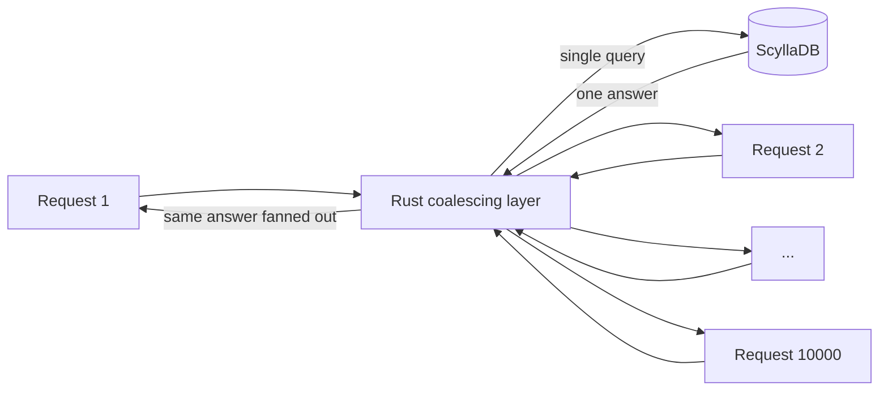

# 08 — Request Coalescing: The Rust Layer

## The problem the database alone cannot solve

- **10,000 people open the same busy channel at the same moment**, all asking for the exact same messages ([`14:32`](https://www.youtube.com/watch?v=X4iAQkjtx5k&t=872)).
- Without protection that is **10,000 identical requests** hammering the database for **the same answer** ([`14:32`](https://www.youtube.com/watch?v=X4iAQkjtx5k&t=872)).

## The solution: a Rust middle layer

- Discord built a layer that sits **between their app and the database**, written in **Rust** — fast and memory-safe ([`14:56`](https://www.youtube.com/watch?v=X4iAQkjtx5k&t=896)).
- Its job is one technique: **request coalescing** ([`14:56`](https://www.youtube.com/watch?v=X4iAQkjtx5k&t=896)).

### How coalescing works

1. The layer acts like a bouncer at a door ([`15:13`](https://www.youtube.com/watch?v=X4iAQkjtx5k&t=913)).
2. It sends **only the first request** to the database.
3. The other **9,999 identical requests are held** — "wait here, I'm already getting it".
4. When the answer arrives, it is **handed to everybody**.
5. Net effect: **one trip to the database instead of 10,000** ([`15:13`](https://www.youtube.com/watch?v=X4iAQkjtx5k&t=913)).

## Why it matters: hot partitions attacked at a different level

- Previously, a viral channel slammed all its traffic straight into the database ([`15:35`](https://www.youtube.com/watch?v=X4iAQkjtx5k&t=935)).
- Now the Rust layer **absorbs the storm**; the database only ever sees a calm, sensible amount of traffic no matter how crazy the front door gets ([`15:35`](https://www.youtube.com/watch?v=X4iAQkjtx5k&t=935)).

## Transferable pattern

> When many users want the same thing at the same time, don't ask the database the same question over and over. **Ask once, share the answer**, and put a smart layer in front to absorb the spikes ([`15:59`](https://www.youtube.com/watch?v=X4iAQkjtx5k&t=959)).
