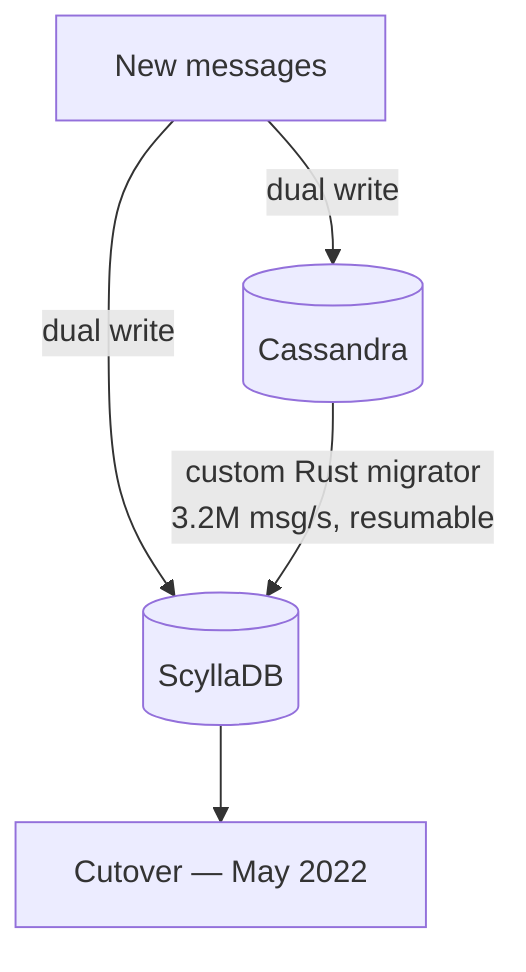

# 09 — Migrating Trillions of Messages With No Downtime

The hardest part: moving **trillions of messages** while millions of people use the app live, with **no downtime** ([`15:59`](https://www.youtube.com/watch?v=X4iAQkjtx5k&t=959)).

## The two-half plan

### Half 1 — New messages: dual writes

- From the cutover moment, every **new message was written to both databases at once** (Cassandra + ScyllaDB), keeping both systems in sync ([`16:19`](https://www.youtube.com/watch?v=X4iAQkjtx5k&t=979), [`16:23`](https://www.youtube.com/watch?v=X4iAQkjtx5k&t=983)).

### Half 2 — Old messages: bulk copy

- The trillions already sitting in Cassandra had to be copied across — the hard part ([`16:23`](https://www.youtube.com/watch?v=X4iAQkjtx5k&t=983)).

## Standard tool vs. custom Rust tool

| | Standard migration tool | Custom Rust tool |
|---|---|---|
| Estimated duration | **3 months** ([`16:43`](https://www.youtube.com/watch?v=X4iAQkjtx5k&t=1003)) | **9 days** ([`17:09`](https://www.youtube.com/watch?v=X4iAQkjtx5k&t=1029)) |
| Throughput | — | up to **3.2 million messages/second** ([`17:09`](https://www.youtube.com/watch?v=X4iAQkjtx5k&t=1029)) |
| Resumability | — | tracked its own progress, resumed where it left off ([`17:09`](https://www.youtube.com/watch?v=X4iAQkjtx5k&t=1029)) |

- Three months was unacceptable: it meant three more months of babysitting a fragile, high-maintenance system and hoping nothing broke ([`16:43`](https://www.youtube.com/watch?v=X4iAQkjtx5k&t=1003)).
- So the engineers built their own tool on their fast **Rust library**, reading straight out of Cassandra and firehosing directly into ScyllaDB ([`16:43`](https://www.youtube.com/watch?v=X4iAQkjtx5k&t=1003)).

## The tombstone cameo at the finish line

- The migration flew, then **got stuck at 99.9999%** ([`17:09`](https://www.youtube.com/watch?v=X4iAQkjtx5k&t=1029)).
- Cause: a giant pile of **old tombstones**, never cleaned up, sitting in the final stretch of data ([`17:34`](https://www.youtube.com/watch?v=X4iAQkjtx5k&t=1054)).
- They cleared that one stubborn range **by hand**, and the rest finished in seconds — the very first problem of the story reappearing at the end ([`17:34`](https://www.youtube.com/watch?v=X4iAQkjtx5k&t=1054)).

## Cutover

- Completed successfully in **May 2022** ([`17:34`](https://www.youtube.com/watch?v=X4iAQkjtx5k&t=1054)).

