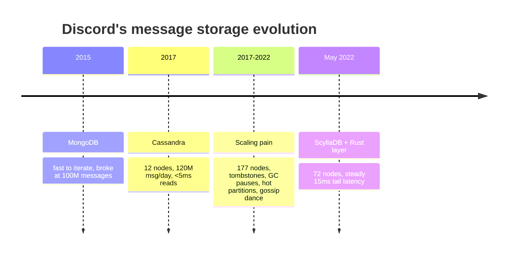

# The Real Reason Discord Left Cassandra

*ByteMonk · 19:40 · [Watch on YouTube](https://www.youtube.com/watch?v=X4iAQkjtx5k)*

## Summary

A system-design case study of how Discord stored chat messages across three database generations: **MongoDB (2015)** → **Apache Cassandra (2017–2022)** → **ScyllaDB (May 2022 onward)**. It starts from a concrete symptom — a channel taking 20 seconds to load one message while the rest of the app served billions a day — and works backwards through the mechanisms behind it: partition keys, time buckets, tombstones, JVM garbage-collection pauses, hot partitions and compaction lag. It then covers the migration: why ScyllaDB's C++ / shard-per-core design removed an entire class of problem, why Discord still needed a custom Rust request-coalescing layer in front of it, and how they moved trillions of messages live with no downtime. The recurring lesson: your database must match your read/write access pattern, and *predictable* beats *fast*.

## Topics

1. [Why Storing Chat Messages Is Hard](01-why-storing-chat-messages-is-hard.md) — the 20-second symptom, the access pattern problem, and the thesis of the video.
2. [MongoDB and Why It Broke](02-mongodb-and-why-it-broke.md) — the right choice for 2015, and why random reads destroyed the cache at 100M messages.
3. [The Wishlist That Led to Cassandra](03-the-wishlist-and-choosing-cassandra.md) — five requirements written *before* choosing a tool.
4. [Partition Keys, Buckets and Snowflake IDs](04-partition-keys-buckets-and-snowflake-ids.md) — the schema decision that worked brilliantly and later backfired.
5. [Tombstones and the Garbage Collector](05-tombstones-and-the-garbage-collector.md) — the actual root cause of the 20-second read.
6. [Five Years of Scaling Pain](06-five-years-of-scaling-pain.md) — hot partitions, GC pauses, compaction lag and the "gossip dance".
7. [ScyllaDB and Shard-Per-Core](07-scylladb-and-shard-per-core.md) — designing the problem out instead of tuning it away.
8. [Request Coalescing: The Rust Layer](08-request-coalescing-the-rust-layer.md) — 10,000 identical requests, one database query.
9. [Migrating Trillions of Messages](09-migrating-trillions-of-messages.md) — dual writes, a custom Rust migrator, and 3 months cut to 9 days.
10. [Before and After, and the World Cup Test](10-results-and-the-world-cup-test.md) — the final numbers and the real-world stress test.

## Key takeaways

- MongoDB held up for roughly **6 months** and broke at **100 million messages**, not because it was a bad database but because Discord's reads were wildly random, leaving no hot/cold split for the cache to exploit — every miss meant a slow disk trip ([`2:29`](https://www.youtube.com/watch?v=X4iAQkjtx5k&t=149), [`3:10`](https://www.youtube.com/watch?v=X4iAQkjtx5k&t=190)).
- Cassandra with a `channel_id + 10-day bucket` partition key and snowflake IDs delivered **sub-10 ms writes, sub-5 ms reads, 120M+ messages/day on 12 machines maintained by 4 engineers** by early 2017 ([`6:20`](https://www.youtube.com/watch?v=X4iAQkjtx5k&t=380), [`7:06`](https://www.youtube.com/watch?v=X4iAQkjtx5k&t=426)).
- The 20-second read was **tombstones**, not a code bug: millions of deleted messages left markers that every read had to scan first ([`7:53`](https://www.youtube.com/watch?v=X4iAQkjtx5k&t=473), [`8:11`](https://www.youtube.com/watch?v=X4iAQkjtx5k&t=491)).
- JVM garbage-collection pauses reached **10 full seconds**, locking nodes; because reads span replicas, one sick node degraded requests cluster-wide ([`8:51`](https://www.youtube.com/watch?v=X4iAQkjtx5k&t=531), [`9:13`](https://www.youtube.com/watch?v=X4iAQkjtx5k&t=553)).
- By 2022 the cluster had grown to **177 machines** and tail latency swung unpredictably between **40 and 120+ ms**, with engineers running a manual "gossip dance" — rotating nodes out so compaction could catch up ([`9:41`](https://www.youtube.com/watch?v=X4iAQkjtx5k&t=581), [`11:36`](https://www.youtube.com/watch?v=X4iAQkjtx5k&t=696)).
- ScyllaDB is Cassandra-compatible (same data model, query language, core ideas) but written in **C++ with no JVM and no garbage collector**, eliminating that entire failure category by design rather than by tuning ([`12:36`](https://www.youtube.com/watch?v=X4iAQkjtx5k&t=756), [`13:06`](https://www.youtube.com/watch?v=X4iAQkjtx5k&t=786)).
- Its **shard-per-core** design gives each CPU core its own memory and data, removing contention and running compaction in parallel — the reason Discord could later run on **fewer than half the machines** ([`13:37`](https://www.youtube.com/watch?v=X4iAQkjtx5k&t=817), [`14:05`](https://www.youtube.com/watch?v=X4iAQkjtx5k&t=845)).
- The Rust **request-coalescing** layer turns 10,000 simultaneous identical requests into **one** database query whose result is fanned out — attacking hot partitions above the database, not inside it ([`15:13`](https://www.youtube.com/watch?v=X4iAQkjtx5k&t=913), [`15:35`](https://www.youtube.com/watch?v=X4iAQkjtx5k&t=935)).
- A custom Rust migrator hit **3.2 million messages/second**, cutting the migration estimate from **3 months to 9 days**; it stalled at **99.9999%** on a pile of old tombstones that had to be cleared by hand, and cutover completed in **May 2022** ([`16:43`](https://www.youtube.com/watch?v=X4iAQkjtx5k&t=1003), [`17:09`](https://www.youtube.com/watch?v=X4iAQkjtx5k&t=1029), [`17:34`](https://www.youtube.com/watch?v=X4iAQkjtx5k&t=1054)).
- Final result: **177 → 72 machines**, tail latency from a 40–120+ ms swing down to a steady **15 ms**, writes at a predictable **5 ms**, handling more data and traffic than before ([`17:56`](https://www.youtube.com/watch?v=X4iAQkjtx5k&t=1076), [`18:06`](https://www.youtube.com/watch?v=X4iAQkjtx5k&t=1086)).
- The 2022 World Cup final — with traffic surging on every goal — was absorbed without incident, and the operational win (no weekend firefights, no manual node nursing) mattered as much as the latency numbers ([`18:28`](https://www.youtube.com/watch?v=X4iAQkjtx5k&t=1108), [`18:57`](https://www.youtube.com/watch?v=X4iAQkjtx5k&t=1137)).
- Transferable principles: write the **requirements wishlist before picking the tool** ([`4:55`](https://www.youtube.com/watch?v=X4iAQkjtx5k&t=295)); when many users want the same thing, **ask once and share the answer** ([`15:59`](https://www.youtube.com/watch?v=X4iAQkjtx5k&t=959)); and when engineers fight the database more than they build the product, the question changes from *how do we tune this* to *what replaces it* ([`12:12`](https://www.youtube.com/watch?v=X4iAQkjtx5k&t=732)).
