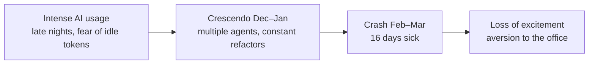

# 2. Crash and Burnout

*Chapter 1 of the video ([`1:11`](https://www.youtube.com/watch?v=iPUn1Fnfn0k&t=73))*

## Adam Elmore's case

- Public post: "the craziest burnout" of a 17-year career, sick for 16 days, unable even to go for walks ([`1:13`](https://www.youtube.com/watch?v=iPUn1Fnfn0k&t=73)).
- The burnout was **preceded by very intense AI usage** — late nights, barely sleeping, excitement to get the next prompt going ([`1:37`](https://www.youtube.com/watch?v=iPUn1Fnfn0k&t=97)).
- The driving belief: *if it wasn't burning tokens, I was leaving something on the table* ([`1:37`](https://www.youtube.com/watch?v=iPUn1Fnfn0k&t=97)).
- Peak around December–January: brainpower and daytime thoughts consumed by prompting, multiple things running at once, constant refactors, everything *feeling* productive ([`2:08`](https://www.youtube.com/watch?v=iPUn1Fnfn0k&t=128)).
- The crash landed roughly February–March ([`2:32`](https://www.youtube.com/watch?v=iPUn1Fnfn0k&t=152)).

### The signal that something was wrong

- No longer excited to wake up — a first in 15–17 years of programming ([`2:32`](https://www.youtube.com/watch?v=iPUn1Fnfn0k&t=152)).
- Sleeping until 7 a.m., hesitant to enter the office, the work felt "soul-sucking" ([`2:58`](https://www.youtube.com/watch?v=iPUn1Fnfn0k&t=178)).

## Clinical framing — Dr. Courtney Tolinski

Symptoms to watch for, which **build on each other** over time ([`3:22`](https://www.youtube.com/watch?v=iPUn1Fnfn0k&t=202), [`3:45`](https://www.youtube.com/watch?v=iPUn1Fnfn0k&t=225)):

- Lack of sleep
- Loss of interest in things you used to enjoy
- Extreme exhaustion
- Anxiety symptoms
- Social withdrawal

Escalation path: unmonitored symptoms → chronic fatigue, no self-care, significant physical anxiety symptoms → the point where treatment may be required ([`3:45`](https://www.youtube.com/watch?v=iPUn1Fnfn0k&t=225)).

### Somatization

- **Definition:** anxiety manifesting as physical symptoms, described as a feedback loop ([`4:22`](https://www.youtube.com/watch?v=iPUn1Fnfn0k&t=262)).
- Forms it takes: headaches, muscle tightness, sleep deprivation, stomach aches or chronic stomach issues ([`4:22`](https://www.youtube.com/watch?v=iPUn1Fnfn0k&t=262)).
- This is the mechanism that makes "you went to the hospital from *prompting*?" a coherent question rather than an absurd one.

## Why the survey exists

- The open question after Adam's story: are these outliers? ([`4:22`](https://www.youtube.com/watch?v=iPUn1Fnfn0k&t=262)).
- Nearly 1,300 responses arrived in one week — evidence that people wanted to talk about it ([`4:56`](https://www.youtube.com/watch?v=iPUn1Fnfn0k&t=296)).
