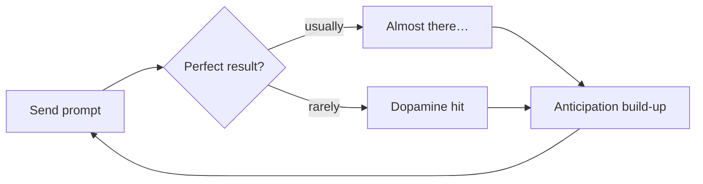

# 3. Why Prompting Is Hard to Put Down

*Chapter 2 of the video ([`5:29`](https://www.youtube.com/watch?v=iPUn1Fnfn0k&t=330))*

## The questions asked

1. How often do you keep prompting — "just one more prompt" — past the point you meant to stop? ([`5:30`](https://www.youtube.com/watch?v=iPUn1Fnfn0k&t=330))
2. How has your sleep changed since you started using AI heavily for coding — later bedtimes, racing thoughts, trouble waking? ([`5:30`](https://www.youtube.com/watch?v=iPUn1Fnfn0k&t=330), [`5:55`](https://www.youtube.com/watch?v=iPUn1Fnfn0k&t=355))

## The numbers

- **46%** regularly blow past their intended stopping point — often or every single day, not once in a while ([`5:55`](https://www.youtube.com/watch?v=iPUn1Fnfn0k&t=355)).
- Among those who overshoot: **58%** report sleep changed moderately or more ([`5:55`](https://www.youtube.com/watch?v=iPUn1Fnfn0k&t=355)).
- Among those who stop when they meant to: **17%** ([`6:23`](https://www.youtube.com/watch?v=iPUn1Fnfn0k&t=383)).
- This is **the strongest relationship in the entire survey** ([`6:23`](https://www.youtube.com/watch?v=iPUn1Fnfn0k&t=383)).
- Caveat stated explicitly: this does not prove AI wrecked anyone's sleep — causation could run the other way or come from something else entirely; the two simply appear together ([`6:23`](https://www.youtube.com/watch?v=iPUn1Fnfn0k&t=383)).

| Group | Sleep changed moderately or more |
|---|---|
| Kept prompting past stopping point | 58% |
| Stopped when intended | 17% |

## The mechanism — variable reward

Dr. Courtney Tolinski's explanation ([`6:23`](https://www.youtube.com/watch?v=iPUn1Fnfn0k&t=383), [`6:53`](https://www.youtube.com/watch?v=iPUn1Fnfn0k&t=413), [`7:16`](https://www.youtube.com/watch?v=iPUn1Fnfn0k&t=436)):

- AI prompting is a **variable reward system**, structurally like a slot machine: sometimes a reward, most of the time not.
- The anticipation build-up is what keeps you pressing the lever.
- Each prompt carries a *chance* of the perfect solution; most outputs fall short, which produces the "let me just do it one more time" loop.
- Chasing the perfect solution induces dopamine, which feeds the addictive cycle.

