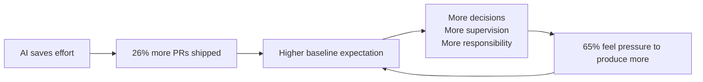

# 4. Saved Time Turns Into Pressure

*Chapter 3 of the video ([`7:39`](https://www.youtube.com/watch?v=iPUn1Fnfn0k&t=460))*

The core question: if AI gives time back, where does that time actually go? ([`7:40`](https://www.youtube.com/watch?v=iPUn1Fnfn0k&t=460))

## The data

- **2026 AI Index report:** developers using GitHub Copilot completed **26% more pull requests** than without ([`7:40`](https://www.youtube.com/watch?v=iPUn1Fnfn0k&t=460)).
- Survey question: how often do you feel you *should* be producing more with AI because it makes it possible — even when you don't want to?
  - **65% feel that pressure often or daily** — two out of every three ([`7:40`](https://www.youtube.com/watch?v=iPUn1Fnfn0k&t=460)).
- The conclusion drawn: the tools work, **and** the people using them feel they should be producing more ([`8:06`](https://www.youtube.com/watch?v=iPUn1Fnfn0k&t=486)).

## Mark Erikson — the escalation logic

The argument, as stated ([`8:06`](https://www.youtube.com/watch?v=iPUn1Fnfn0k&t=486), [`8:40`](https://www.youtube.com/watch?v=iPUn1Fnfn0k&t=520)):

- "If it is possible to go faster, we must go faster."
- The reason for going faster traces back to delivering value to shareholders — capitalism.
- The escalation ladder: one conversation → two, bouncing between them during pauses → four → infinite agents running overnight, prompting and picking up work automatically.

The questions raised against that ladder ([`9:07`](https://www.youtube.com/watch?v=iPUn1Fnfn0k&t=547)):

1. Why are we trying to go this fast in the first place?
2. How much *useful* output are we actually getting?
3. Is the quality good enough?
4. What does the process do to our brains?

## Miranda Heath — the nature of the work changes

- Time shifts **from coding to reviewing and deciding** — and to taking on more responsibility ([`9:27`](https://www.youtube.com/watch?v=iPUn1Fnfn0k&t=567)).
- People report pressure to do more, faster, simply because AI makes it possible ([`9:46`](https://www.youtube.com/watch?v=iPUn1Fnfn0k&t=586)).
- Managers who don't understand the work in practice treat AI as a magic bullet and expect greater capacity and more shipping ([`9:46`](https://www.youtube.com/watch?v=iPUn1Fnfn0k&t=586)).

## The key reframe

Saved effort does **not** come back as saved time or rest. It comes back as ([`9:46`](https://www.youtube.com/watch?v=iPUn1Fnfn0k&t=586), [`10:10`](https://www.youtube.com/watch?v=iPUn1Fnfn0k&t=610)):

- More decisions
- More supervision
- A higher baseline expectation
- The feeling of answering thousands of questions a day at rapid fire

