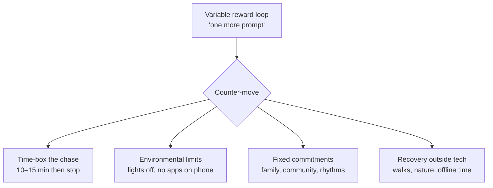

# 7. Practices That Work

*Chapter 6 of the video ([`17:52`](https://www.youtube.com/watch?v=iPUn1Fnfn0k&t=1075))*

Guiding question: how do we keep up coding capability without making burnout the default? ([`17:55`](https://www.youtube.com/watch?v=iPUn1Fnfn0k&t=1075))

Notable convergence: many of the psychologist's recommendations were **already in Aaron Francis's daily life** ([`17:55`](https://www.youtube.com/watch?v=iPUn1Fnfn0k&t=1075)).

## Clinical recommendations — Dr. Courtney Tolinski

- **Set time limits on the chase.** When it's *almost* there but not the perfect solution, give it 10–15 minutes; if it doesn't land, stop and move on. This is the direct countermeasure to the variable reward system ([`18:14`](https://www.youtube.com/watch?v=iPUn1Fnfn0k&t=1094)).
- **General self-care principles** — obvious but underweighted: walks, mindfulness or deep breathing, relaxation, exercise ([`18:42`](https://www.youtube.com/watch?v=iPUn1Fnfn0k&t=1122)).
- **Do things outside technology** that bring you back to nature and reconnect you to yourself ([`19:07`](https://www.youtube.com/watch?v=iPUn1Fnfn0k&t=1147)).
- **Talk to your community — don't just talk to AI.** A therapist can help build healthy boundaries and systems; human connection is what produces a sense of joy ([`19:07`](https://www.youtube.com/watch?v=iPUn1Fnfn0k&t=1147)).

## Environmental limits — Aaron Francis

Boundaries built into the environment rather than relying on willpower:

- **Office lights on a timer, off at 5:00 p.m.** — you leave because you won't sit in the dark ([`18:14`](https://www.youtube.com/watch?v=iPUn1Fnfn0k&t=1094), [`18:42`](https://www.youtube.com/watch?v=iPUn1Fnfn0k&t=1122)).
- **Weekend rule (self-imposed, not imposed by a spouse):** laptop allowed only when the kids are asleep; kids awake on a weekend means being dad ([`19:35`](https://www.youtube.com/watch?v=iPUn1Fnfn0k&t=1175)).
- **Fixed social rhythms** that make constant prompting impossible even when tempted: church every Sunday morning, small-group Bible study every Tuesday night, a monthly lunch with friends ([`19:59`](https://www.youtube.com/watch?v=iPUn1Fnfn0k&t=1199)).
- **No prompting apps on the phone** ([`19:59`](https://www.youtube.com/watch?v=iPUn1Fnfn0k&t=1199)).
- The stated motivation: not missing his kids' childhood over "extra tokens on something that didn't end up mattering" ([`19:35`](https://www.youtube.com/watch?v=iPUn1Fnfn0k&t=1175)).

## Recovery habits — Adam Elmore

- Deliberately developed a habit of **time outside**: an hour-long walk through the woods at a nature center 20 minutes away, once or twice a week in the mornings — "that helped me a ton" ([`20:32`](https://www.youtube.com/watch?v=iPUn1Fnfn0k&t=1232)).
- Time with family and his two kids ([`20:45`](https://www.youtube.com/watch?v=iPUn1Fnfn0k&t=1245)).
- **Far less time on Twitter** and online generally — a lot more offline time ([`20:45`](https://www.youtube.com/watch?v=iPUn1Fnfn0k&t=1245)).

## The pattern behind all of them

None of these rely on in-the-moment willpower — they remove the option before the pull arrives.
