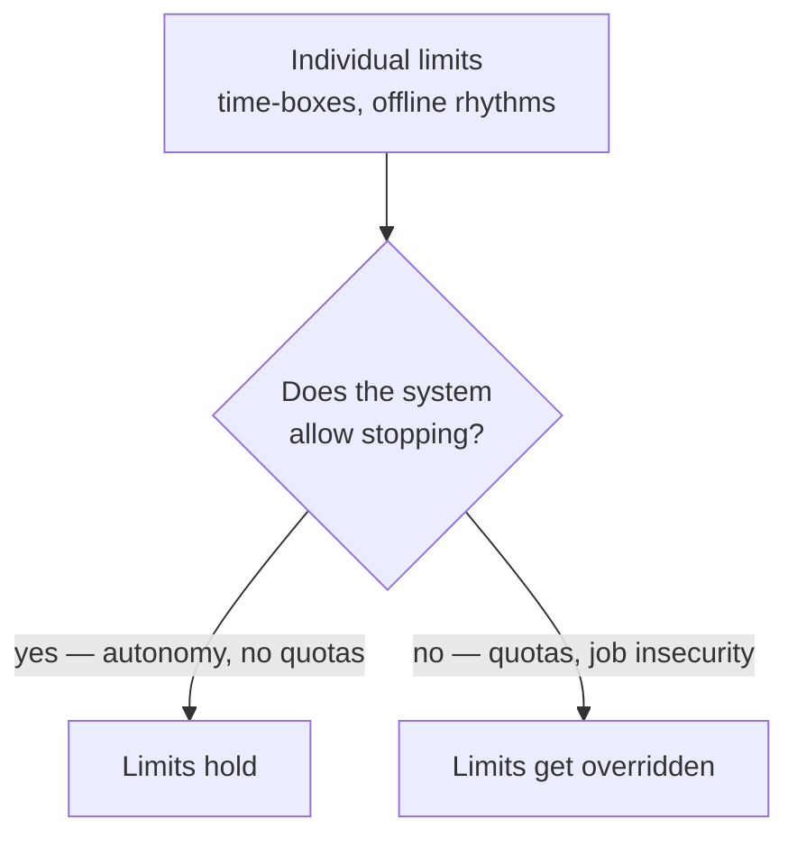

# 8. Why Discipline Alone Isn't Enough

*Closing argument of Chapter 6 ([`20:45`](https://www.youtube.com/watch?v=iPUn1Fnfn0k&t=1245) onward)*

## The structural caveat on every tip

Aaron Francis **works for himself** ([`20:45`](https://www.youtube.com/watch?v=iPUn1Fnfn0k&t=1245), [`21:05`](https://www.youtube.com/watch?v=iPUn1Fnfn0k&t=1265)):

- No one dictates how many lines of code he must ship.
- No deploy quotas, no manager breathing down his neck.
- He sets his own schedule and his own boundaries.

Every recommendation in the previous topic — set a limit, phone in another room, close the computer, stop at the correct time — **assumes you can do that without getting fired**, and that you feel safe in your workplace ([`21:05`](https://www.youtube.com/watch?v=iPUn1Fnfn0k&t=1265)).

## The labor-market data (2026 AI Index report)

- Employment for software developers **aged 22–25 is down close to 20%** from its 2022 peak ([`21:33`](https://www.youtube.com/watch?v=iPUn1Fnfn0k&t=1293)).
- Every age group **over 30** in the same data kept growing ([`21:33`](https://www.youtube.com/watch?v=iPUn1Fnfn0k&t=1293)).
- Narrowed to the jobs most exposed to AI, that group is down about **16% relative to the least exposed** ([`21:33`](https://www.youtube.com/watch?v=iPUn1Fnfn0k&t=1293)).

**The honest counterpoint, stated in the video:** unemployment rose across *every* kind of job in that window — and it rose **more for the jobs least exposed to AI**. So this is **not proof that AI took those jobs** ([`21:33`](https://www.youtube.com/watch?v=iPUn1Fnfn0k&t=1293), [`22:03`](https://www.youtube.com/watch?v=iPUn1Fnfn0k&t=1323)).

## Why that matters for boundaries

- If you're 23 and it feels like the ladder is being pulled up behind you, you will push hard — past the boundaries that people with more control can afford to keep ([`22:03`](https://www.youtube.com/watch?v=iPUn1Fnfn0k&t=1323)).
- **Healthy prompting cannot be carried by personal discipline alone.** The worker *and* the workplace determine whether stopping on time is even possible ([`22:03`](https://www.youtube.com/watch?v=iPUn1Fnfn0k&t=1323), [`22:28`](https://www.youtube.com/watch?v=iPUn1Fnfn0k&t=1348)).

## Not entirely new

- Pre-AI there were already jobs requiring major overtime to ship, pushing well past the desired limit, with negative mental health effects ([`22:28`](https://www.youtube.com/watch?v=iPUn1Fnfn0k&t=1348)).
- What the data does show is that **people feel they need to produce more now than ever** ([`22:28`](https://www.youtube.com/watch?v=iPUn1Fnfn0k&t=1348)).

## Closing position

- Among survey respondents, AI changed more than how fast software gets made — it changed **pressure, sleep, enjoyment, and how capable people felt** ([`22:56`](https://www.youtube.com/watch?v=iPUn1Fnfn0k&t=1376)).
- The three interviewees each found a way through ([`22:56`](https://www.youtube.com/watch?v=iPUn1Fnfn0k&t=1376)):
  - **Adam** came back from the burnout.
  - **Aaron** built limits into his workflow.
  - **Mark** stayed the one making decisions and controlling his code.
- Individual limits only matter if the surrounding systems permit stopping at all ([`22:56`](https://www.youtube.com/watch?v=iPUn1Fnfn0k&t=1376)).
- The call to action: figure out what healthy AI-assisted workflows look like **before maximum output 24/7 becomes the baseline** ([`23:26`](https://www.youtube.com/watch?v=iPUn1Fnfn0k&t=1406)).

## Follow-ups mentioned

- The survey remains open and data collection continues ([`23:26`](https://www.youtube.com/watch?v=iPUn1Fnfn0k&t=1406)).
- Hundreds of free-text responses were received and are still to be compiled into a further analysis ([`23:51`](https://www.youtube.com/watch?v=iPUn1Fnfn0k&t=1431)).
