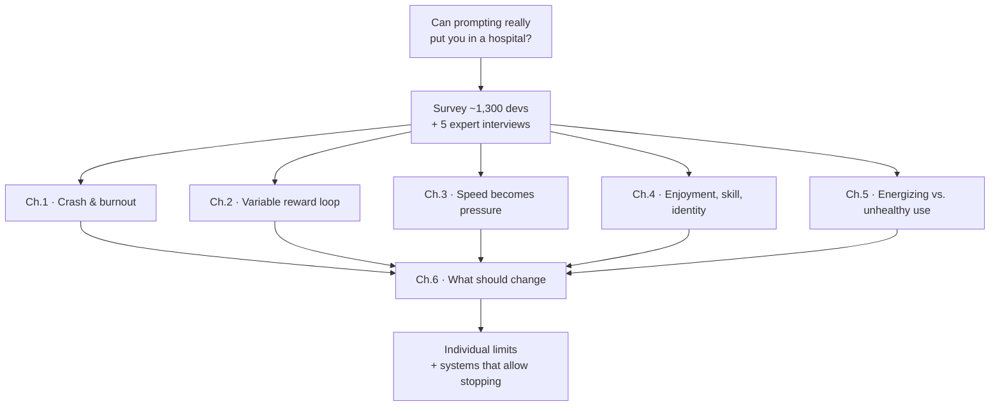

# The True Cost of AI Coding

*Syntax · 24:27 · [Watch on YouTube](https://www.youtube.com/watch?v=iPUn1Fnfn0k)*
_Interesting Links_: https://ai-health.syntax.fm/

## Summary

Scott Tolinski investigates what heavy AI-assisted coding is doing to developers' mental health. The trigger was a viral tweet about a developer hospitalized after an all-night token-burning session, plus a public burnout post from a 17-year veteran. The video combines a survey of nearly 1,300 self-selected developers with interviews from five voices: a burned-out developer (Adam Elmore), a licensed psychologist (Dr. Courtney Tolinski), a Redux maintainer (Mark Erikson), a burnout researcher (Miranda Heath), and a heavy AI user with no negative effects (Aaron Francis).

It works through five questions in order: why prompting is hard to stop, why saved time turns into pressure instead of rest, what happens to enjoyment and skill, what separates energizing use from destructive use, and what should actually change. It ends on a structural argument — personal boundaries only work if your workplace lets you keep them.

## Topics

1. [The Question and the Method](01-the-question-and-the-method.md) — the viral hospitalization, the survey, its stated limits, and who speaks in the video.
2. [Crash and Burnout](02-crash-and-burnout.md) — Adam Elmore's timeline into burnout, clinical warning signs, and somatization.
3. [Why Prompting Is Hard to Put Down](03-why-prompting-is-hard-to-put-down.md) — the 46% / 58% / 17% findings and the slot-machine mechanism.
4. [Saved Time Turns Into Pressure](04-saved-time-turns-into-pressure.md) — 26% more PRs, 65% feeling pressure, and effort returning as supervision instead of rest.
5. [Enjoyment, Skill, and Identity](05-enjoyment-skill-and-identity.md) — the 59% / 54% overlap, Mark Erikson's slower workflow, result vs. answer, neuroplasticity.
6. [What Separates Energizing Use From Unhealthy Use](06-energizing-vs-unhealthy-use.md) — Aaron Francis's counter-case and the agent-count correlations.
7. [Practices That Work](07-practices-that-work.md) — time-boxing, environmental limits, fixed rhythms, recovery habits.
8. [Why Discipline Alone Isn't Enough](08-discipline-is-not-enough.md) — labor-market data, the autonomy caveat, and the closing position.

## Key takeaways

- **46% of respondents regularly prompt past their intended stopping point**, often or daily ([`5:55`](https://www.youtube.com/watch?v=iPUn1Fnfn0k&t=355)).
- **The strongest relationship in the whole survey:** 58% of those who overshoot report sleep changed moderately or more, versus just 17% of those who stop on time — presented as correlation, explicitly not causation ([`6:23`](https://www.youtube.com/watch?v=iPUn1Fnfn0k&t=383)).
- **The mechanism is a variable reward system**, structurally identical to a slot machine: the chance of a perfect solution drives the "one more time" loop and the dopamine that sustains it ([`6:53`](https://www.youtube.com/watch?v=iPUn1Fnfn0k&t=413)).
- **The tools do work, and that's the problem:** Copilot users completed 26% more pull requests, while 65% of respondents feel pressure to produce more often or daily ([`7:40`](https://www.youtube.com/watch?v=iPUn1Fnfn0k&t=460)).
- **Saved effort does not return as rest.** It returns as more decisions, more supervision, more responsibility, and a higher baseline ([`10:10`](https://www.youtube.com/watch?v=iPUn1Fnfn0k&t=610)).
- **59% believe their coding skills are diminishing and 54% enjoy coding less — and it's mostly the same people** ([`10:53`](https://www.youtube.com/watch?v=iPUn1Fnfn0k&t=653)).
- **A result is not an answer.** It becomes one when a person evaluates it and takes responsibility for it — the accountability step is what preserves agency ([`12:14`](https://www.youtube.com/watch?v=iPUn1Fnfn0k&t=734)).
- **Unused skills decay.** Neuroplasticity means the brain drops what you stop practicing; the basics survive, advanced ability doesn't ([`12:45`](https://www.youtube.com/watch?v=iPUn1Fnfn0k&t=765), [`13:17`](https://www.youtube.com/watch?v=iPUn1Fnfn0k&t=797)).
- **Two in three respondents run only one or two agents**; fewer than 200 run four or more ([`16:13`](https://www.youtube.com/watch?v=iPUn1Fnfn0k&t=973)).
- **More agents correlated with higher enjoyment, more sleep disturbance, and *less* perceived skill loss** — with the data at four to five agents flagged as too thin to conclude from ([`16:28`](https://www.youtube.com/watch?v=iPUn1Fnfn0k&t=988), [`17:03`](https://www.youtube.com/watch?v=iPUn1Fnfn0k&t=1023)).
- **Depth beats breadth as an anti-burnout strategy:** narrowing from 40 products to one or two with a real moat removed the urgency to ship overnight ([`15:04`](https://www.youtube.com/watch?v=iPUn1Fnfn0k&t=904), [`15:44`](https://www.youtube.com/watch?v=iPUn1Fnfn0k&t=944)).
- **The effective countermeasures are environmental, not willpower-based:** a 10–15 minute time-box on the chase, office lights on a timer, no prompting apps on the phone, fixed family and community commitments ([`18:14`](https://www.youtube.com/watch?v=iPUn1Fnfn0k&t=1094), [`19:59`](https://www.youtube.com/watch?v=iPUn1Fnfn0k&t=1199)).
- **Employment for developers aged 22–25 is down close to 20% from its 2022 peak** while every group over 30 grew — though unemployment rose more in the jobs *least* exposed to AI, so it isn't proof AI took those jobs ([`21:33`](https://www.youtube.com/watch?v=iPUn1Fnfn0k&t=1293), [`22:03`](https://www.youtube.com/watch?v=iPUn1Fnfn0k&t=1323)).
- **Healthy prompting can't be carried by personal discipline alone** — individual limits only matter if the workplace makes stopping possible ([`22:28`](https://www.youtube.com/watch?v=iPUn1Fnfn0k&t=1348), [`22:56`](https://www.youtube.com/watch?v=iPUn1Fnfn0k&t=1376)).
