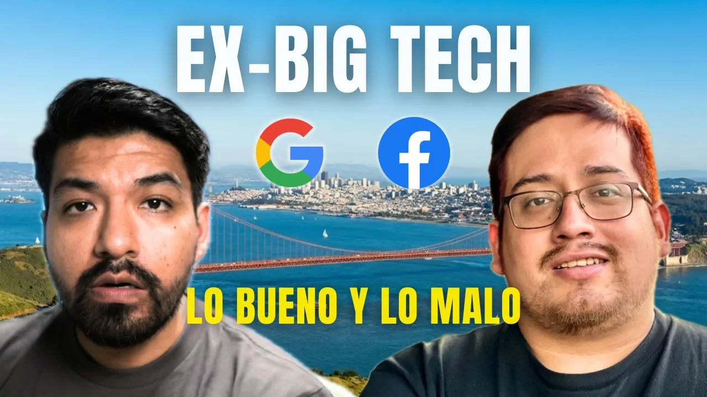

# Trabajó en Google, Facebook y YouTube: Hablando con Ingeniero de Silicon Valley 🔴

Entrevista informal de Diego Veloper a Freddy Ramírez, ingeniero de software peruano radicado en California desde 2017. La conversación recorre su paso por WhatsApp, Facebook, Google y YouTube, su trabajo posterior en startups y las decisiones prácticas que rodean una carrera internacional: inglés, entrevistas, referencias, visas, formación, seniority y herramientas de desarrollo. [`17:29`](https://www.youtube.com/watch?v=CclzcMfDQfs&t=1049)

**Clasificación:** podcast/entrevista técnica con preguntas de la audiencia.

## Temas

1. [Trayectoria en Big Tech y motivos para cambiar](01-trayectoria-y-cambios.md)
2. [Cultura laboral, beneficios y vida en California](02-cultura-laboral-y-california.md)
3. [Inglés para estudiar, trabajar y vivir](03-ingles-para-la-carrera.md)
4. [Herramientas y prácticas de ingeniería](04-practicas-y-herramientas.md)
5. [Currículum, referencias y primeras oportunidades](05-curriculum-referencias-y-practicas.md)
6. [Entrevistas técnicas y preparación](06-entrevistas-y-preparacion.md)
7. [Visas y rutas desde Latinoamérica](07-visas-y-rutas-internacionales.md)
8. [Universidad, aprendizaje autodidacta e IA](08-formacion-y-aprendizaje.md)
9. [Seniority, mercado y elección de empresa](09-seniority-y-eleccion-de-empresa.md)

## Key takeaways

- Una referencia abre la puerta, pero no sustituye la preparación: el candidato debe superar por sí mismo todas las entrevistas. [`59:18`](https://www.youtube.com/watch?v=CclzcMfDQfs&t=3558) [`1:00:06`](https://www.youtube.com/watch?v=CclzcMfDQfs&t=3606)
- Freddy dejó WhatsApp/Facebook cuando cambió la cultura del equipo y dejó YouTube por aburrimiento, poco impacto percibido, herramientas demasiado internas y un giro hacia trabajo full stack que no coincidía con su interés en móvil. [`1:03:17`](https://www.youtube.com/watch?v=CclzcMfDQfs&t=3797) [`1:04:24`](https://www.youtube.com/watch?v=CclzcMfDQfs&t=3864) [`1:05:35`](https://www.youtube.com/watch?v=CclzcMfDQfs&t=3935)
- Para entrevistas de Big Tech, practicar algoritmos sigue siendo uno de los filtros más transferibles; para startups tempranas puede pesar más construir el producto que resolver grafos. [`1:01:18`](https://www.youtube.com/watch?v=CclzcMfDQfs&t=3678) [`1:26:05`](https://www.youtube.com/watch?v=CclzcMfDQfs&t=5165)
- Desde Latinoamérica, la visa H-1B introduce una lotería. Freddy propone entrar primero a una sede europea de una Big Tech y pedir un traslado interno después de al menos un año. [`1:30:13`](https://www.youtube.com/watch?v=CclzcMfDQfs&t=5413) [`1:30:46`](https://www.youtube.com/watch?v=CclzcMfDQfs&t=5446)
- En el uso profesional de IA, la experiencia permite cuestionar, reorganizar y corregir lo generado; quien aún aprende puede aceptar una solución defectuosa sin reconocer sus fallas. [`1:39:22`](https://www.youtube.com/watch?v=CclzcMfDQfs&t=5962) [`1:39:44`](https://www.youtube.com/watch?v=CclzcMfDQfs&t=5984)
- En empresas estadounidenses, seniority incluye liderazgo, mentoría y gestión, no solo habilidad para programar; el trabajo independiente cuenta cuando implica dirigir el proyecto completo y al equipo. [`1:49:16`](https://www.youtube.com/watch?v=CclzcMfDQfs&t=6556) [`1:50:31`](https://www.youtube.com/watch?v=CclzcMfDQfs&t=6631) [`1:51:25`](https://www.youtube.com/watch?v=CclzcMfDQfs&t=6685)
- Una maestría puede mejorar el nivel inicial, pero la diferencia pierde importancia con los ascensos; su valor es mayor cuando especializa en un campo concreto. [`1:54:28`](https://www.youtube.com/watch?v=CclzcMfDQfs&t=6868) [`1:55:39`](https://www.youtube.com/watch?v=CclzcMfDQfs&t=6939)

