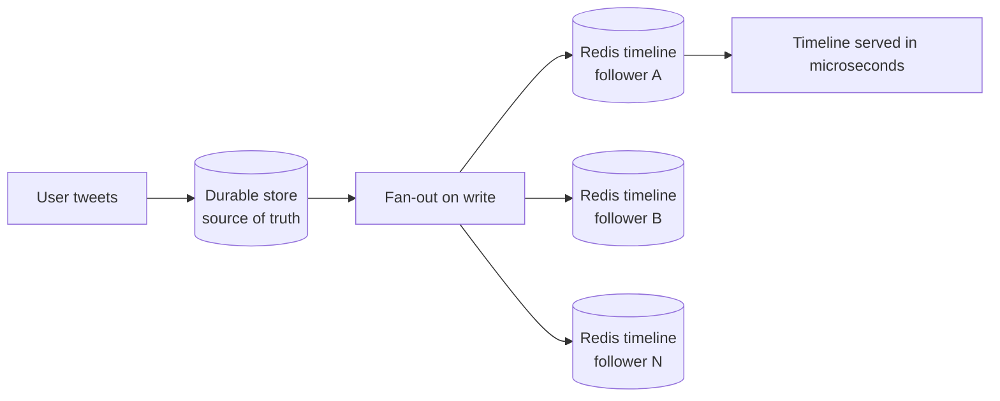

# 04 — Twitter and Redis: Pre-computed Timelines

## The problem: the timeline

- Opening Twitter must show the most recent tweets from everyone you follow, **instantly** — not 200 ms, not 100 ms ([`6:06`](https://www.youtube.com/watch?v=XjHZCprrEgk&t=366))
- Deceptively hard: a user may follow **2,000 accounts**, each tweeting multiple times a day ([`6:06`](https://www.youtube.com/watch?v=XjHZCprrEgk&t=366), [`6:24`](https://www.youtube.com/watch?v=XjHZCprrEgk&t=384))
- Those tweets must be merged, ranked and served in **single-digit milliseconds** ([`6:24`](https://www.youtube.com/watch?v=XjHZCprrEgk&t=384))

## The choice: Redis — as a cache, not a database

- Timelines are served from Redis at **over 300,000 requests per second per node** ([`6:37`](https://www.youtube.com/watch?v=XjHZCprrEgk&t=397))
- Timelines are **pre-computed**, not assembled on request ([`6:37`](https://www.youtube.com/watch?v=XjHZCprrEgk&t=397))

## Fan-out on write

- When a user tweets, Twitter does **not wait for followers to request it** ([`6:37`](https://www.youtube.com/watch?v=XjHZCprrEgk&t=397))
- The tweet is **pushed into the Redis timeline cache of every follower** ([`7:00`](https://www.youtube.com/watch?v=XjHZCprrEgk&t=420))
- By the time you open the app, your timeline is **already assembled and sitting in memory** ([`7:00`](https://www.youtube.com/watch?v=XjHZCprrEgk&t=420))

Why Redis makes this work:

- Operates **entirely in memory** — no disk read, no query parsing, no index lookup ([`7:00`](https://www.youtube.com/watch?v=XjHZCprrEgk&t=420))
- The timeline is a **pre-built list in RAM**; reading it takes **microseconds** ([`7:18`](https://www.youtube.com/watch?v=XjHZCprrEgk&t=438))

## Redis is never the source of truth

- Twitter treats Redis strictly as a **cache**; actual tweets live in a **durable database** ([`7:29`](https://www.youtube.com/watch?v=XjHZCprrEgk&t=449))
- The pattern seen at almost every large company ([`7:29`](https://www.youtube.com/watch?v=XjHZCprrEgk&t=449)):
  1. Write to the durable store **first**
  2. Replicate to Redis
  3. Read from Redis
  4. If Redis fails, **fall back to the durable store**
- Companies that skip the source-of-truth step and use Redis as their primary database eventually write a postmortem about lost user data ([`7:51`](https://www.youtube.com/watch?v=XjHZCprrEgk&t=471))
- **Redis can lose data on restart by default** — it is designed for speed, not durability ([`7:51`](https://www.youtube.com/watch?v=XjHZCprrEgk&t=471))

## The celebrity problem and the hybrid strategy

- Edge case: an account with **80 million followers** tweets → fan-out on write means **80 million Redis list updates for a single tweet**, which is insanely expensive ([`8:09`](https://www.youtube.com/watch?v=XjHZCprrEgk&t=489))
- Twitter's hybrid solution ([`8:09`](https://www.youtube.com/watch?v=XjHZCprrEgk&t=489)):

| Account type | Strategy |
|---|---|
| Regular users | **Fan-out on write** — tweets pre-pushed to followers' timelines |
| Celebrity accounts (millions of followers) | **Fan-out on read** — resolved at request time |

- On timeline load, Twitter **merges the pre-built Redis timeline with real-time lookups** of tweets from celebrity accounts you follow ([`8:34`](https://www.youtube.com/watch?v=XjHZCprrEgk&t=514))
- Takeaway: this nuance is what separates real system design from textbook concepts — **there is no one-size-fits-all solution, even within a single feature** ([`8:34`](https://www.youtube.com/watch?v=XjHZCprrEgk&t=514))
