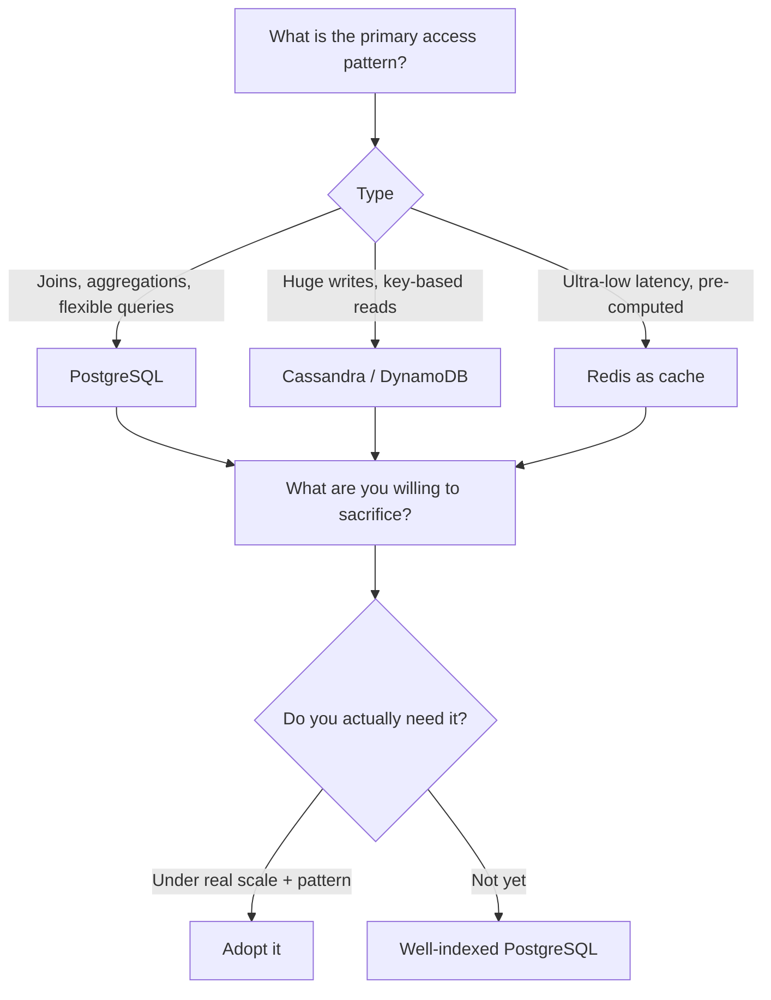

# 05 — The Three-Question Framework for Choosing a Database

## Question 1 — What is your primary access pattern?

| Access pattern | Choice |
|---|---|
| Flexible queries with joins and aggregations | Lean **relational**, e.g. PostgreSQL ([`8:53`](https://www.youtube.com/watch?v=XjHZCprrEgk&t=533)) |
| Massive write throughput with predictable key-based reads | **Cassandra or DynamoDB** ([`8:53`](https://www.youtube.com/watch?v=XjHZCprrEgk&t=533)) |
| Ultra-low latency reads of pre-computed data | **Redis as a caching layer** ([`9:14`](https://www.youtube.com/watch?v=XjHZCprrEgk&t=554), [`9:18`](https://www.youtube.com/watch?v=XjHZCprrEgk&t=558)) |

## Question 2 — What are you willing to sacrifice?

Every database optimizes for some things **by giving up others** ([`9:18`](https://www.youtube.com/watch?v=XjHZCprrEgk&t=558)):

| Database | Gives you | Takes away |
|---|---|---|
| PostgreSQL | Query flexibility | Struggles with massive write throughput |
| Cassandra | Write scale | Query flexibility |
| Redis | Speed | Durability and storage capacity |

*(all three rows: [`9:18`](https://www.youtube.com/watch?v=XjHZCprrEgk&t=558))*

## Question 3 — Do you actually need it?

- Called out as **the most important question** ([`9:41`](https://www.youtube.com/watch?v=XjHZCprrEgk&t=581), [`9:44`](https://www.youtube.com/watch?v=XjHZCprrEgk&t=584))
- **Most systems don't need fancy databases** ([`9:44`](https://www.youtube.com/watch?v=XjHZCprrEgk&t=584))
- A **well-indexed PostgreSQL handles more load than 95% of applications will ever see** ([`9:44`](https://www.youtube.com/watch?v=XjHZCprrEgk&t=584))
- Don't choose Cassandra because Netflix uses it when your app has **10,000 users** — choose it when you actually have the access pattern and scale that demand it ([`9:44`](https://www.youtube.com/watch?v=XjHZCprrEgk&t=584))

