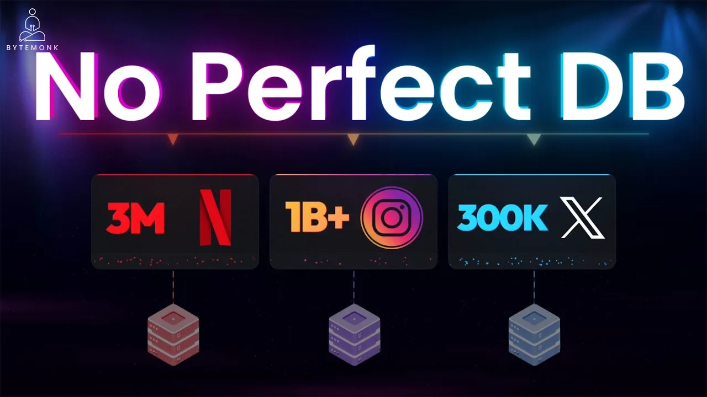
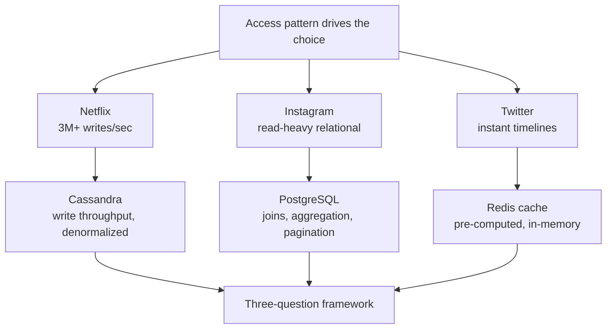

# Why Netflix, Instagram, and Twitter Pick Different Databases

*ByteMonk · 10:49 · https://www.youtube.com/watch?v=XjHZCprrEgk*

## Summary

A system design explainer that reverse-engineers the database choices of three large platforms — Netflix (Cassandra), Instagram (PostgreSQL) and Twitter (Redis) — and argues that none of them is "the best database": each was chosen because it matched that company's access pattern. For each case the video walks through the workload, the internal mechanics that make the chosen database fit, the trade-off accepted in exchange, and what would have broken with a different choice. It closes with a three-question framework for making the decision yourself, plus a warning against copying big-tech architecture at small scale.

## Topics

1. [Three Companies, Three Choices](01-three-companies-three-choices.md)
2. [Netflix and Cassandra: Write Throughput at Scale](02-netflix-cassandra.md)
3. [Instagram and PostgreSQL: Relational Access Patterns](03-instagram-postgresql.md)
4. [Twitter and Redis: Pre-computed Timelines](04-twitter-redis-timelines.md)
5. [The Three-Question Framework for Choosing a Database](05-choosing-a-database-framework.md)
6. [Final System Design Takeaways](06-final-takeaways.md)

## Key takeaways

- Database choice is driven by access pattern, not by an absolute ranking — the database that is perfect for one company would be a disaster for another ([`0:00`](https://www.youtube.com/watch?v=XjHZCprrEgk&t=0), [`0:25`](https://www.youtube.com/watch?v=XjHZCprrEgk&t=25))
- Netflix's 260 million subscribers generate **3+ million writes/sec**; Cassandra absorbs it because a write is a hashed partition-key route into an in-memory memtable, acknowledged with no locks and no cross-node coordination ([`0:56`](https://www.youtube.com/watch?v=XjHZCprrEgk&t=56), [`1:22`](https://www.youtube.com/watch?v=XjHZCprrEgk&t=82), [`1:46`](https://www.youtube.com/watch?v=XjHZCprrEgk&t=106))
- The price Netflix pays: no joins, no ad hoc queries, and the same data stored several times in query-shaped tables — denormalization is the strategy, not a bug ([`2:10`](https://www.youtube.com/watch?v=XjHZCprrEgk&t=130), [`2:26`](https://www.youtube.com/watch?v=XjHZCprrEgk&t=146), [`2:46`](https://www.youtube.com/watch?v=XjHZCprrEgk&t=166))
- Using Cassandra like a relational database (multi-partition queries, secondary indexes) produces **~200 ms read latencies** — a design failure, not a database failure ([`2:46`](https://www.youtube.com/watch?v=XjHZCprrEgk&t=166))
- Postgres at Netflix's write volume would need an army of instances plus a complex sharding layer; Cassandra gives horizontal write scaling natively ([`3:06`](https://www.youtube.com/watch?v=XjHZCprrEgk&t=186))
- Instagram ran its whole backend on PostgreSQL past **a billion users** because its workload is read-heavy and relational: joins, aggregations, filtering and sorted pagination ([`3:59`](https://www.youtube.com/watch?v=XjHZCprrEgk&t=239), [`4:16`](https://www.youtube.com/watch?v=XjHZCprrEgk&t=256))
- Making Postgres hold up took four concrete techniques: PgBouncer connection pooling, read replicas, table partitioning and indexing tuned to avoid full table scans ([`4:53`](https://www.youtube.com/watch?v=XjHZCprrEgk&t=293), [`5:20`](https://www.youtube.com/watch?v=XjHZCprrEgk&t=320))
- With Cassandra, every new feature would demand a new denormalized pipeline; with Postgres it is a new query — flexibility is a product-velocity feature, not just a technical one ([`4:37`](https://www.youtube.com/watch?v=XjHZCprrEgk&t=277), [`4:53`](https://www.youtube.com/watch?v=XjHZCprrEgk&t=293))
- Instagram still uses other stores for messaging, real-time notifications and analytics — the win was not abandoning Postgres for the *core* use case ([`5:47`](https://www.youtube.com/watch?v=XjHZCprrEgk&t=347))
- Twitter serves timelines from Redis at **300,000+ requests/sec per node** by fanning out on write: each tweet is pushed into every follower's cached list, so reads are microsecond RAM lookups with no disk, parsing or index work ([`6:37`](https://www.youtube.com/watch?v=XjHZCprrEgk&t=397), [`7:00`](https://www.youtube.com/watch?v=XjHZCprrEgk&t=420), [`7:18`](https://www.youtube.com/watch?v=XjHZCprrEgk&t=438))
- Redis is never the source of truth: write to the durable store first, replicate to Redis, read from Redis, fall back on failure — Redis can lose data on restart by default ([`7:29`](https://www.youtube.com/watch?v=XjHZCprrEgk&t=449), [`7:51`](https://www.youtube.com/watch?v=XjHZCprrEgk&t=471))
- The celebrity case breaks pure fan-out-on-write (**80 million list updates for one tweet**), so Twitter uses a hybrid: fan-out on write for regular users, fan-out on read for celebrities, merged at request time ([`8:09`](https://www.youtube.com/watch?v=XjHZCprrEgk&t=489), [`8:34`](https://www.youtube.com/watch?v=XjHZCprrEgk&t=514))
- The decision framework is three questions: what is the access pattern, what are you willing to sacrifice, and do you actually need it ([`8:53`](https://www.youtube.com/watch?v=XjHZCprrEgk&t=533), [`9:18`](https://www.youtube.com/watch?v=XjHZCprrEgk&t=558), [`9:44`](https://www.youtube.com/watch?v=XjHZCprrEgk&t=584))
- Explicit trade-off map: Postgres = flexibility vs. write throughput, Cassandra = write scale vs. query flexibility, Redis = speed vs. durability and capacity ([`9:18`](https://www.youtube.com/watch?v=XjHZCprrEgk&t=558))
- A well-indexed PostgreSQL handles more load than **95% of applications** will ever see — don't adopt Cassandra at 10,000 users just because Netflix uses it ([`9:44`](https://www.youtube.com/watch?v=XjHZCprrEgk&t=584))
- All three companies were right at once, because the real skill is matching data, queries and trade-offs to a tool — not memorizing which database is fastest ([`10:03`](https://www.youtube.com/watch?v=XjHZCprrEgk&t=603), [`10:19`](https://www.youtube.com/watch?v=XjHZCprrEgk&t=619))
