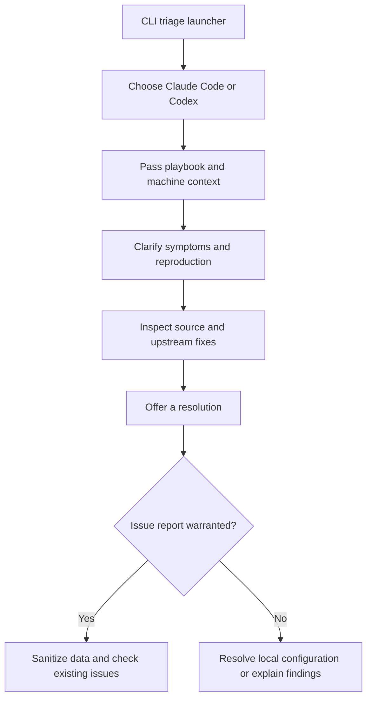

# A support workflow built around a prompt

## Problem and design

- Windows crashes led Theo to write debugging prompts for affected users. He turned that approach into T3 CLI triage so support could still run when the desktop application would not open. [`13:49`](https://www.youtube.com/watch?v=m-B3jIMMmUE&t=829) [`14:23`](https://www.youtube.com/watch?v=m-B3jIMMmUE&t=863)
- The launcher asks the user to choose Claude Code or Codex, then passes a prompt into that coding agent. It also supplies a context file containing basic facts about the local T3 Code installation. [`15:03`](https://www.youtube.com/watch?v=m-B3jIMMmUE&t=903) [`15:24`](https://www.youtube.com/watch?v=m-B3jIMMmUE&t=924)
- The prompt assigns the agent a support-engineer role: investigate the problem, unblock the user, and produce a useful GitHub issue when warranted. [`15:49`](https://www.youtube.com/watch?v=m-B3jIMMmUE&t=949)

## Playbook sequence

1. Ask the user what went wrong in their own words. Request screenshots when available and ask follow-up questions for vague descriptions. [`16:13`](https://www.youtube.com/watch?v=m-B3jIMMmUE&t=973)
2. Extract reproducible steps, which Theo calls the most valuable information from the conversation. Read machine facts and check for a newer version of the public playbook. [`16:39`](https://www.youtube.com/watch?v=m-B3jIMMmUE&t=999)
3. Obtain the open-source application code, investigate, check whether upstream already fixes the bug, and offer ways to resolve the problem. [`16:54`](https://www.youtube.com/watch?v=m-B3jIMMmUE&t=1014)
4. Distinguish a local configuration problem from a reportable issue. Remove secrets and other sensitive data before posting. Prefer adding evidence to an existing issue over opening a duplicate. [`17:07`](https://www.youtube.com/watch?v=m-B3jIMMmUE&t=1027)

The flow summarizes the launcher and playbook described in the demonstration. [`15:03`](https://www.youtube.com/watch?v=m-B3jIMMmUE&t=903) [`15:24`](https://www.youtube.com/watch?v=m-B3jIMMmUE&t=924) [`16:13`](https://www.youtube.com/watch?v=m-B3jIMMmUE&t=973) [`16:54`](https://www.youtube.com/watch?v=m-B3jIMMmUE&t=1014) [`17:07`](https://www.youtube.com/watch?v=m-B3jIMMmUE&t=1027)

## Reported result and lesson

- Theo says the feature was heading toward thousands of lines of code, then became about five lines of code plus 30 lines of Markdown and worked better. He provides no comparative success rate or support-time measurement. [`17:30`](https://www.youtube.com/watch?v=m-B3jIMMmUE&t=1050)
- Image pasting illustrates the saved work: the existing coding agent can ask for an image, so the triage launcher does not need its own image-routing interface. [`17:30`](https://www.youtube.com/watch?v=m-B3jIMMmUE&t=1050)
- His argument for the design is that support has unknown branches and failure modes. A conversational playbook can investigate cases that a fixed support flow did not anticipate. [`17:53`](https://www.youtube.com/watch?v=m-B3jIMMmUE&t=1073) [`18:19`](https://www.youtube.com/watch?v=m-B3jIMMmUE&t=1099)
