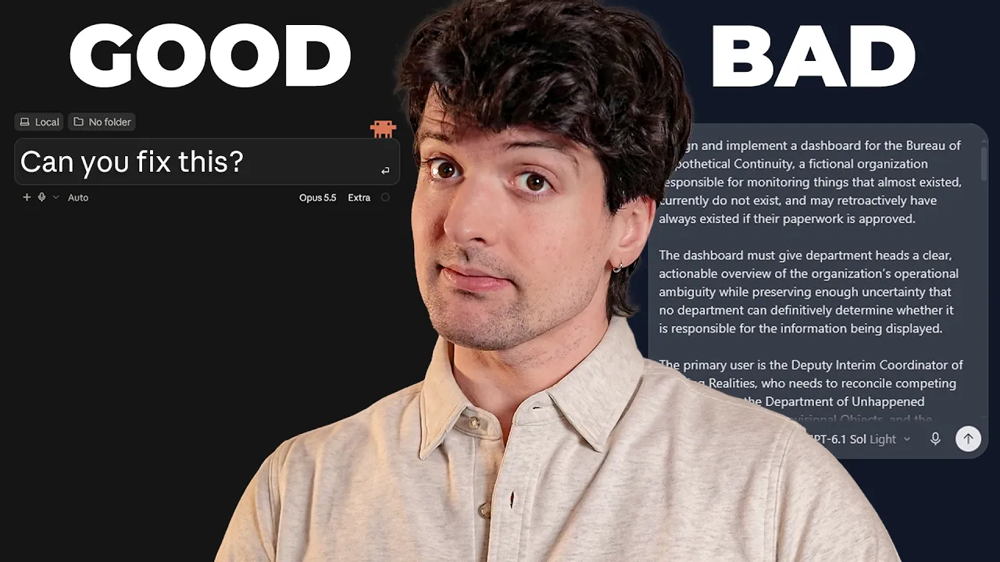

# Your prompts kinda suck

Theo argues that engineers often build interfaces and workflows for outcomes they could request directly from an agent. Through T3 Code demonstrations, he shows how prompts can produce diagnostics, coordinate agents, and guide support conversations. His proposed engineering focus is to give agents better data, tools, and connections. [`0:19`](https://www.youtube.com/watch?v=m-B3jIMMmUE&t=19) [`13:49`](https://www.youtube.com/watch?v=m-B3jIMMmUE&t=829) [`22:50`](https://www.youtube.com/watch?v=m-B3jIMMmUE&t=1370)

Video: [Your prompts kinda suck](https://www.youtube.com/watch?v=m-B3jIMMmUE) · Theo - t3․gg · 31:47

Classification: opinion-led educational video with demonstrations. Results below are demonstrations or Theo's reports, rather than controlled benchmarks. The [complete transcript](transcript.md) is included.

## Topic breakdown

1. [Rethinking what to ask an agent](01-rethinking-prompts.md) · 0:00–1:42
2. [Sponsor example: targeted code review](02-sponsor-code-review.md) · 1:42–3:52
3. [Requesting diagnostics instead of product features](03-diagnostics-as-prompts.md) · 3:52–11:33
4. [Prompting delegation and saving repeatable workflows](04-delegation-and-reuse.md) · 11:33–13:49
5. [A support workflow built around a prompt](05-prompt-driven-triage.md) · 13:49–18:45
6. [Asking agents what data and tools they lack](06-discovering-capabilities.md) · 18:45–21:38
7. [Connecting personal data and agent systems](07-connected-workflows.md) · 21:38–24:58
8. [What remains worth engineering](08-what-to-build.md) · 24:58–31:47

## Key takeaways

- An on-demand tool-call report found one home-directory search lasting 41.7 minutes and another lasting almost 10 minutes. Theo's practical response is to search the repository or a known directory. [`8:57`](https://www.youtube.com/watch?v=m-B3jIMMmUE&t=537)
- A context audit revealed that his Railway proxy setup had inserted roughly 70,000 tokens into every request. He says this went unnoticed for two months. [`9:44`](https://www.youtube.com/watch?v=m-B3jIMMmUE&t=584) [`10:06`](https://www.youtube.com/watch?v=m-B3jIMMmUE&t=606)
- A prompt started two Opus 5.5 delegates for server and client performance exploration. The requested Grok 4.7 implementation handoff is described, but its completion is not shown in this segment. [`12:00`](https://www.youtube.com/watch?v=m-B3jIMMmUE&t=720) [`12:59`](https://www.youtube.com/watch?v=m-B3jIMMmUE&t=779)
- Theo reports reducing a triage feature he expected to require thousands of lines to about five lines of code and 30 lines of Markdown, using Claude Code or Codex to conduct the support conversation. [`15:03`](https://www.youtube.com/watch?v=m-B3jIMMmUE&t=903) [`17:30`](https://www.youtube.com/watch?v=m-B3jIMMmUE&t=1050)
- After connecting email accounts, Theo says his inbox checks fell from about 10 per day to roughly one. This is a personal report, not a measured productivity study. [`23:49`](https://www.youtube.com/watch?v=m-B3jIMMmUE&t=1429)
- His design recommendation is to build the data access and tools that let agents fulfill many requests, and save useful repeated prompts as skills or agent instructions. [`12:59`](https://www.youtube.com/watch?v=m-B3jIMMmUE&t=779) [`13:21`](https://www.youtube.com/watch?v=m-B3jIMMmUE&t=801) [`22:50`](https://www.youtube.com/watch?v=m-B3jIMMmUE&t=1370) [`27:41`](https://www.youtube.com/watch?v=m-B3jIMMmUE&t=1661)
